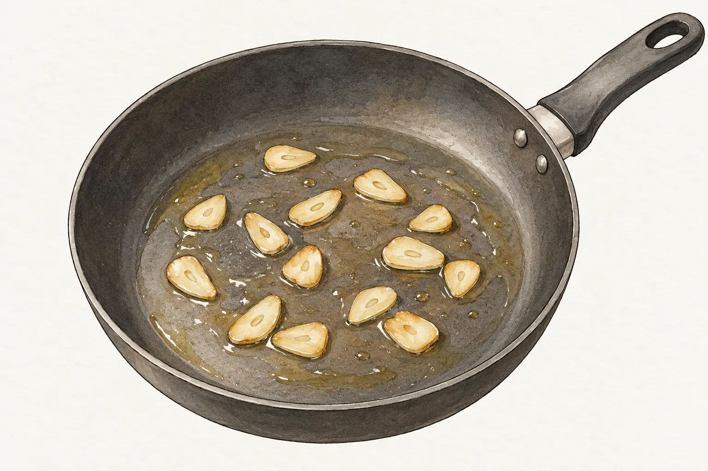
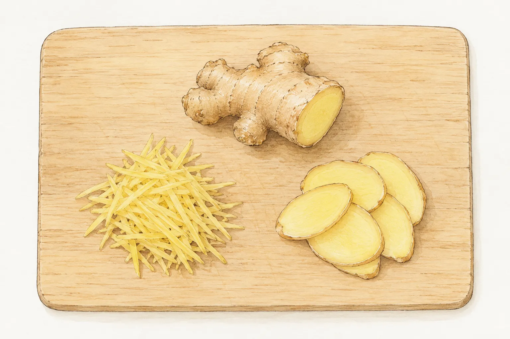
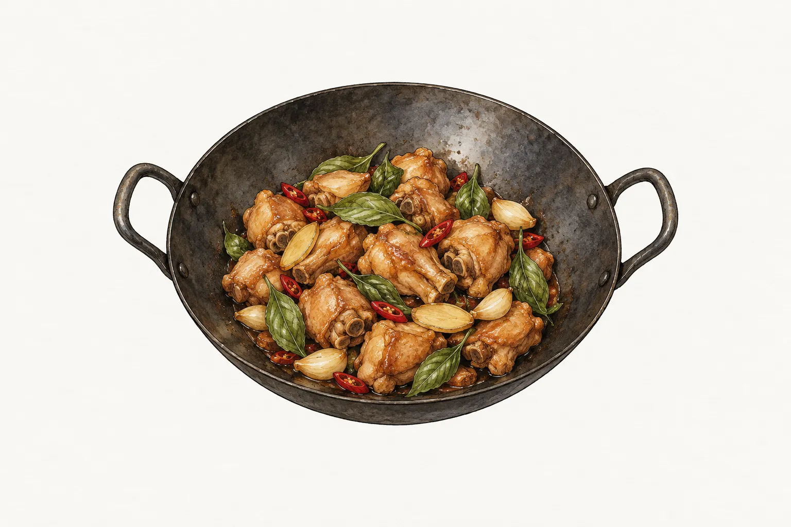

在市場買齊大蒜、青蔥、薑和九層塔，回家還得決定各自怎麼切、什麼時候下鍋。蒜炒花椰菜先處理蒜片，薑絲蛤蜊湯卻讓薑直接進滾水；三杯雞裡的薑片和九層塔，也分別出現在開頭與收尾。材料都叫辛香料，配方安排的工作並不相同。

讀菜譜時，可以沿著步驟找出它第一次出現的位置，再看前後還有哪些食材。是先在油裡煸、等主料暫時盛起後再炒，還是和湯一起煮？本文比較四道家常菜的具體做法，沒有把某一道的順序當成所有料理通用的規則。

## 蒜片先煸，花椰菜另行汆燙

蒜炒花椰菜把蒜片與蔬菜分開處理。愛料理作者阿卿刊載的配方，先將花椰菜和紅蘿蔔汆燙，接著用小火煸蒜片，等蒜片變成金黃色，才加入蔬菜轉大火炒。金黃色是這份做法提供的觀察點，並沒有要求從蒜片下鍋起固定計時。

本站的[蒜炒花椰菜](/recipes/garlic-broccoli/)也採這個先後安排。備料時，大蒜要切成片，白、綠花椰菜切小朵，紅蘿蔔切片；汆燙好的蔬菜先瀝乾備用，再開始煸蒜。如此讀到「放入蔬菜」時，手邊已有能接著下鍋的材料，不必讓蒜片留在鍋裡，才回頭切花椰菜。

這裡談的是蒜片，不把它換成整瓣大蒜或蒜末後，仍照同一個外觀判斷。本站與外部配方的份量不同，本文只比較共同的操作順序。實際採買與調味，仍回到選定菜譜的材料表，不把兩份的大蒜數量拼在一起。蒜片變色之前，蔬菜還在鍋外；等兩者會合，才進到下一段快炒。看步驟圖片時，也應分清這兩個不同的鍋內狀態。

本站這份兩人份配方，用白花椰菜和綠花椰菜各一百公克，搭配三十公克紅蘿蔔與兩瓣大蒜。材料表裡的蒜片是這盤蔬菜的一部分；若今晚只想炒綠花椰菜，這已經是另外調整配方的問題，本文不替換材料後另算用量。先從原配方認識操作，再決定是否另找適合手邊食材的版本。

## 蔥段何時炒，要連著牛肉的進出看

蔥爆牛肉的蔥，安排在牛肉兩次下鍋之間。本站[蔥爆牛肉](/recipes/scallion-beef/)先把牛肉片炒到表面變白，暫時盛起，再以小火炒蔥段、薑絲和辣椒絲，加入這一階段的醬油與水，最後讓牛肉回鍋。辛香料這一步有自己的空檔，並不是從生牛肉下鍋就一直與它同炒。

讀這道菜的準備清單，除了切好蔥段，還要留意醃肉與炒醬汁各自使用的醬油和水。主料已經盛起時，接著要用的是炒醬汁那一份。把材料用途分清楚，才不會把原本留到後段的調味，在醃肉時全部倒完。

蔥白、蔥綠也不一定每份配方都一起下。主婦聯盟楊芷菡的另一份蔥爆牛肉，把青蔥切段後分開，先炒洋蔥與蔥白，之後才加入蔥綠、辣椒，再讓牛肉回鍋。那份菜譜含洋蔥，本站版本則沒有，蔥段也沒有另列蔥白、蔥綠兩階段。兩種安排各有完整步驟，選定一份照著做即可，不必替本站多添一道來源不同的炒洋蔥程序。

本站兩人份材料中的青蔥有一百五十公克，搭配一百八十公克牛肉，並非起鍋時撒上一小撮蔥花的安排。備料時把完整蔥段準備好，閱讀步驟時也把它當成需要下鍋炒的一份材料，才不會把蔥全留到最後裝飾。

## 薑絲可以入湯，薑片另看煸炒步驟

薑在蛤蜊湯裡直接進水。本站[薑絲蛤蜊湯](/recipes/clam-ginger-soup/)把薑切細絲，待水大滾後和蛤蜊一起放入。這份清湯沒有先倒油煸薑的步驟，不能因為另一道菜會爆香，就替它補上一輪油炒。

文青家的廚房刊載的薑絲蛤蜊湯，則先在滾水中放薑絲，等再次煮滾才下蛤蜊，最後另加米酒與蔥花。這與本站同時下薑絲、蛤蜊的版本不同，共同之處是薑絲都直接入湯。準備本站那一鍋時，便把薑絲與蛤蜊安排在同一個下鍋階段；選另一份配方，就保留它的先後次序。

換成三杯雞，薑又是另一種模樣。本站使用薑片，與整瓣大蒜一起用小火煸，觀察薑片邊緣出現微焦、捲起的狀態，再接著下主料。切絲入湯與切片煸炒，對應的是不同料理，不能只記住「薑要先下」，卻漏看它是進湯鍋還是油鍋。

## 九層塔留到收汁後，備料時先放一旁

三杯雞裡的九層塔留在最後。龜甲萬刊載、李德全設計的配方，先以小火炒薑片和辣椒，雞肉加調味烹煮後再移入砂鍋，等湯汁收乾才拌入九層塔。它沒有把九層塔和前段的薑片一起下鍋，也沒有使用大蒜；這些都是那一份配方自己的安排。

本站[三杯雞](/recipes/three-cup-chicken/)含整瓣大蒜，主要步驟用炒鍋完成。打開鍋蓋後繼續翻炒，等醬汁減少並附在雞肉上，再把九層塔拌進去起鍋。這裡要看的訊號是鍋裡醬汁的狀態，不把前面加蓋燜煮的時間，直接當成九層塔下鍋的倒數。

備料時先挑掉九層塔粗莖，洗淨瀝乾，另放一旁。薑片、大蒜準備進鍋時，它還不用跟上。今天若安排蒜炒花椰菜和蛤蜊湯，就分別留好蒜片與薑絲；想做三杯雞，再把薑片、整瓣大蒜與收尾的九層塔分開備妥。購物清單可以放在同一張紙上，下鍋順序仍逐道回到各自菜譜。
