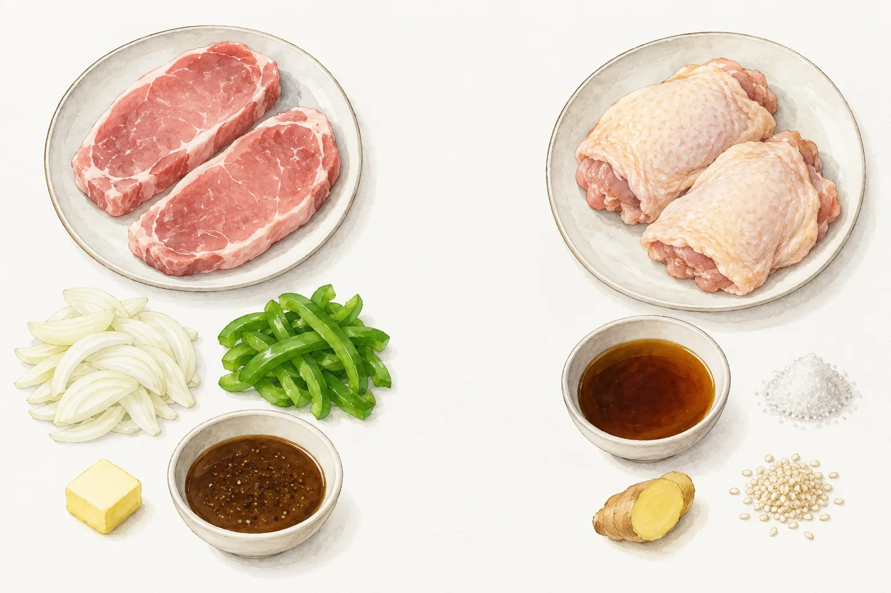
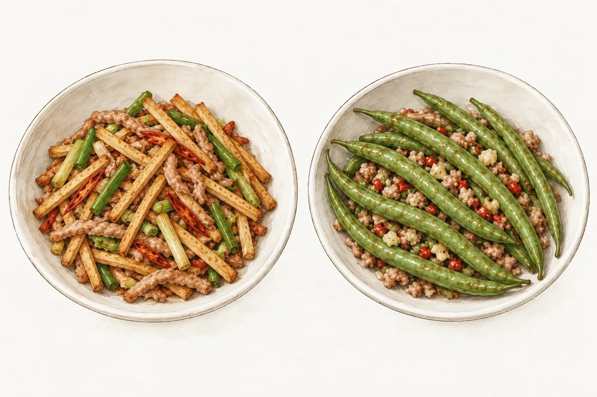
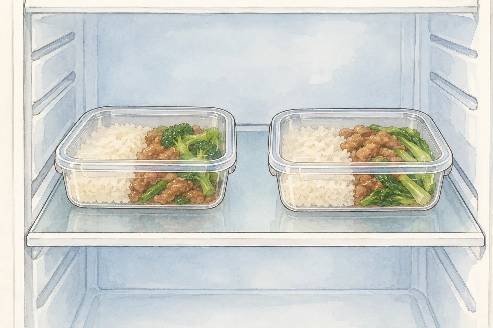

白飯上放一塊排骨，旁邊留些位置裝蛋、豆乾與蔬菜，是臺鐵排骨便當裡看得到的組合。到了家裡，主菜可以換成黑胡椒豬排，也可以煎一片照燒雞腿。選菜時先看想吃哪一種醬汁，再看看家中有哪些配料，比照著一張便當照片湊齊每樣菜更容易安排。

要帶出門吃，還得在買菜前想好飯盒放哪裡。家中煮好、路上攜帶、到目的地等待午餐，這幾段都算在保存安排裡。餐盒有沒有分格，可以按菜色挑；有沒有冷藏和充分加熱的條件，則會影響這一餐適不適合帶。

## 一盒飯，從長途旅程談起

國史館臺灣文獻館刊載的曾令毅講座回顧，把鐵路便當放回長途旅行的需要來看。車程長，車站與列車便有餐食需求；回顧提到，1914 年已有以日本米或臺灣米搭配菜餚的車站便當。當時的鐵路便當由民間承攬，後來臺鐵成立餐旅服務所，才加入經營。

排骨的做法也經過改變。依這份講座回顧，1956 年推出的是炸排骨菜飯，1961 年又有先炸再滷的調整。這是研究者在講座裡整理的發展脈絡，不能把今天吃到的一盒飯，直接當作每個年代都相同的菜單。想在家重做某一年的版本，還需要那個版本的配方與記錄。

現在臺鐵的「排骨便當（列車供應）」商品介紹，列有白飯、排骨、蛋、豆干丁與蔬菜等食材，同時註明蔬菜隨季節變化，餐盒及配菜依實際出貨。白飯旁邊的幾格菜，原本就留有調整的空間。家裡借用這種主菜配飯的組合，能從現有菜譜選自己想吃的口味，不必把黑胡椒或照燒的做法說成臺鐵配方。

## 豬排與雞腿，先看醬汁要準備什麼

本站的[黑胡椒豬排](/recipes/pork-chops-black-pepper/)用里肌肉排，搭配奶油、洋蔥與青椒，調味靠現成黑胡椒醬。買菜時除了肉，也要把醬料算進去；只有黑胡椒粒，並不等於已備妥這份配方的黑胡椒醬。洋蔥和青椒已寫在同一道菜裡，想把它們一起裝盒，可以先看肉排與配料需要多少位置。

[照燒雞腿排](/recipes/teriyaki-chicken-thigh/)則用去骨雞腿，醬汁除了醬油與味醂，還用米酒、生薑及細砂糖，完成後另撒熟白芝麻。選這道時，要核對的是這組調味料，不必另外買黑胡椒醬。雞腿煮好後會切塊，和以整片肉排為主的豬排相比，裝盒時能分成數塊安排。

同名菜仍有不同版本。吳致萱在《食譜自由配》示範的黑胡椒豬排，採先炸、再與洋蔥和醬汁拌燒；詹姆士在《型男大主廚》的照燒雞腿，醬汁用清酒，還搭配洋蔥和花椰菜。這些示範能看出兩類醬汁的材料差異，實際下鍋仍要跟著所選的一份配方。本站用米酒的雞腿，不宜接上另一份清酒配方的比例或時間。

如果已決定吃雞腿，就從雞腿那份材料表開始採買；若家中正好有黑胡椒醬與里肌肉排，則可選豬排。兩道都能配飯，這裡按食材與調味選擇，沒有把任何一道當作鐵路滷排骨的替代做法。

## 豆乾切絲，青菜留出自己的位置

主菜確定後，再選配菜，較容易看出材料有沒有重複。本站[豆乾肉絲](/recipes/tofu-pork-strips/)把五香豆乾切成細絲，與豬肉絲、青蔥及辣椒一起調味。它同時有豆乾和豬肉；若前面已選了一片豬排，這一格又會加進一份肉。可以按這餐想吃的內容決定要不要加，不需要為了多湊一道，就把整份菜譜都裝進同一個人的飯盒。

想以青菜為主，可以看[乾煸四季豆](/recipes/dry-fried-green-beans/)。這份配方用整根四季豆，搭配較細碎的豬絞肉，和豆乾肉絲的細條形態不同。選長形飯盒時，可以先比一下豆子的長度與分格位置。這只是選容器的安排，不是另改切法或縮短烹調時間。

乾煸四季豆也有絞肉、蒜、薑與辣椒，不能把菜名裡有「豆」就視為純素菜。要替別人帶飯，先對過食材，比只問想吃豬排還是雞腿更完整。這兩道配菜都另有完整菜譜，選定後再看材料用量與操作；不以成品的綠色、皺皮或照片，單獨判斷四季豆已經熟透。

## 裝好飯盒，還要安排冷藏與加熱

豆乾與醬汁菜是否耐放，不能只靠吃起來鹹不鹹判斷。食藥署的食品中毒問答建議，已烹調食品與易腐敗食品保存在 5°C 以下；食品調製後，一般室溫放置不要超過 2 小時，環境超過 32°C 時縮為 1 小時。等車、通勤與到辦公室後放在桌上的時間，都不能漏算。

因此，出門前要確認目的地能不能冷藏，吃飯前有沒有合適的加熱設備。冷藏條件不確定時，可以改成在家現做現吃，不把飯盒放到中午再碰運氣。飯菜分格方便盛裝，也不代表能在室溫多放幾個小時。

分裝時用乾淨容器與工具，生肉的刀具、砧板不要直接拿來處理熟食。食藥署也提醒食品要充分加熱，中心溫度超過 70°C；這項一般指引不能拿來補救先前長時間失溫的飯菜，因為部分細菌產生的毒素耐熱。午餐前的加熱，得和前面的保存一起安排。

出門到用餐之間若需要冷藏，就先確認家中與目的地的冰箱都有合適的保存溫度，並安排路上的保存方式。到目的地後，將需要冷藏的飯盒放回冰箱，不留在桌上等午餐。
