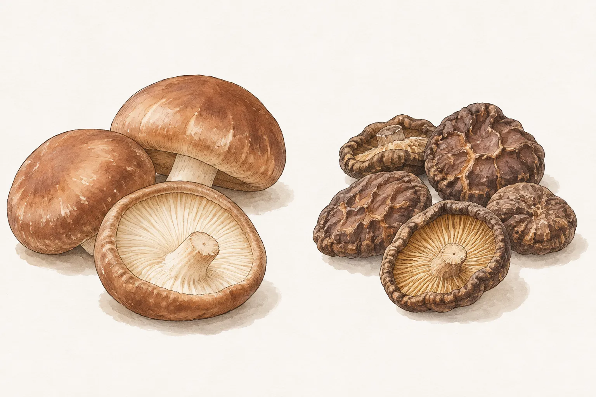
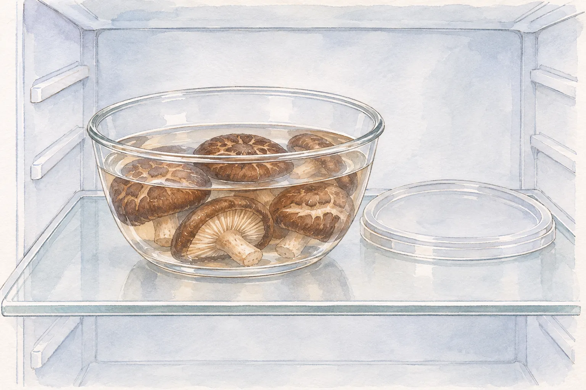
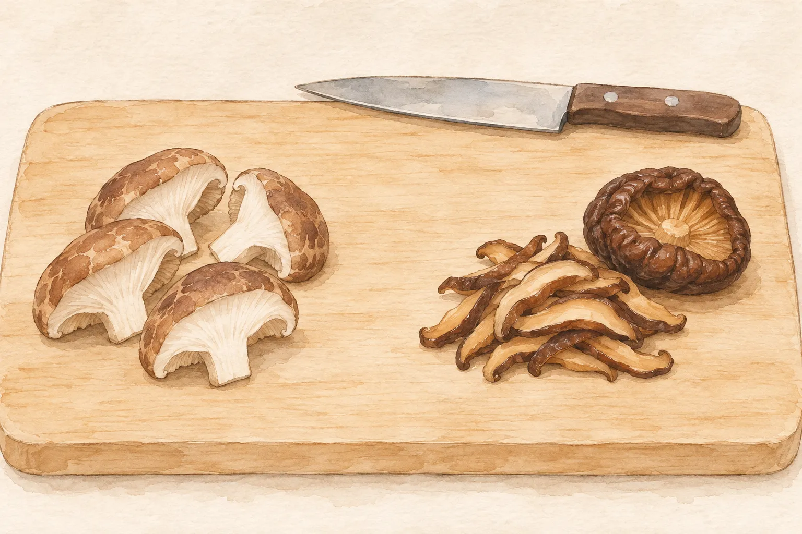

香菇炒青菜可以用鮮菇，雞湯則常見乾菇。買菜時先看配方寫哪一種，回家才知道要直接備料，還是把泡發時間也排進去。乾香菇經過脫水，外觀、氣味與保存方式都和鮮菇不同，不能只按朵數換過去，其他工序卻完全不動。

廚房裡同時放著鮮菇和乾菇時，可以分成兩次選擇：先決定今天要做的菜，再確認剩下的食材如何保存。這篇把挑選、收存與下鍋前的處理分開，最後對照本站兩道菜譜，不另給一套適用所有香菇的泡水時間。

## 鮮菇與乾菇，看外觀的方式不同

挑鮮菇時，可以看菇體是否結實、表面是否乾爽，避開明顯皺縮的個體。香港食安中心的鮮菇指引還建議留意色澤是否均勻。臺灣農業知識入口網的選購資料則提醒，鮮香菇的菌褶與菇柄不宜帶有褐色斑塊。把菇傘翻過來看，能補足只看頂面時漏掉的部位。

乾香菇本來就有皺褶，不能拿鮮菇的外觀要求來篩選。農業知識入口網提到，乾香菇的菌褶可呈淡黃至黃色，選購也可留意菇香；鮮香菇的氣味原本較淡。兩種形態擺在一起時，深淺與氣味差異都要連同乾、鮮狀態判斷。

這些外觀線索用來挑選食材，無法證明食材一定安全。出現黏液或不正常氣味時應避用，也不要把「聞不出異味」當成保存妥當的證據。包裝上的品名、保存方式與期限仍要一起看，不能只靠菇傘大小或照片決定。

## 鮮菇先冷藏，乾菇留意防潮

鮮菇買回家後應儘快冷藏，準備烹煮時再清洗、切開。香港食安中心把這幾個動作放在不同階段：收存是先冷藏，清洗與切割則留到做菜前。若今天只用一部分，可以先取出需要的量，其他繼續照包裝指示保存。

乾菇開封後仍要防潮。埔里鎮農會的乾香菇商品標示要求保持乾燥，開封後密封冷藏；農業知識入口網也提到開封乾菇的密封冷藏安排。買不同產品時，應以各自包裝指示為準，不能把某一袋的有效期限當成所有乾菇的保存天數。

收存前先分清「尚未泡水的乾菇」與「已泡發的菇」。後者已經進入備料流程，不能再沿用乾貨的保存方式。若家人接手煮飯，把正在泡的那份與尚未使用的乾菇分開放，並交代何時開始浸泡，比只說「香菇在冰箱」更容易接續處理。

## 泡乾菇，把時間與存放位置一起安排

乾菇先用流動的乾淨水沖洗，再放進清潔容器浸泡。一次準備當餐需要的份量即可。農業部的香菇料理資料有以冷水泡至軟化的做法，但沒有因此得到所有乾香菇共用的分鐘數；整朵、厚薄與所選配方不同，備料時仍須看手上產品和食譜的要求。

香港食安中心建議，乾菇在室溫浸泡一般不宜超過兩小時；需要較久時，應放入冰箱。這是浸泡過程的食安建議，不是「泡滿兩小時就會軟」的保證，也不是泡好後還能在檯面多放兩小時。準備晚餐時，可先核對預計開始煮的時間，避免泡著泡著便忘了處理。

泡發後應儘快烹煮。若已出現黏糊或異味，食安中心建議丟棄。換水、沖洗或再煮一遍，都不應被當成重新判定可用的理由。冷藏也不代表可以無限延後使用；不確定當天是否要煮，先別把整袋乾菇都泡下去。

部分配方會使用泡菇水。農業部整理的料理例子就有這種安排，但保留的前提仍是乾菇、容器與浸泡過程處理妥當。配方沒有交代時，不必為了「增加香味」自行把整份泡水倒進去；尤其來源不明或保存經過不清楚的泡菇水，不應只憑顏色決定用途。

## 要切塊拌炒，還是整朵入湯

鮮菇可以直接依配方清洗、切開，再進入炒菜工序。本站的[香菇炒青江菜](/recipes/shiitake-bok-choy/)選用鮮香菇，切成兩半後與青江菜拌炒。這道菜的起點很清楚，買回來的鮮菇不必先套用乾菇的浸泡程序。

農業部整理的另一種做法，是將泡軟的乾香菇切成細絲，炒香後加入米粉湯。切法可以跟著菜色選：要跟其他細料一起炒，就先依配方處理成條狀；要在湯裡留下整朵菇，就另選整朵入鍋的版本。換一份食譜時，先重新確認它用的是鮮菇、未泡乾菇，還是已泡軟的香菇。

本站[香菇雞湯](/recipes/shiitake-chicken-soup/)的主做法採乾菇沖洗後直接隨雞肉入鍋，不先泡水；農業部列出的雞湯例子則先泡軟。兩者是不同配方的安排，閱讀時應從同一份材料表與步驟一路往下做。直接入鍋的乾菇與已泡軟的菇，不能自行套用另一份食譜的烹調時間。

採買時可以先決定今晚做鮮菇炒菜，或選一份工序完整的乾菇湯品。手上只有另一種香菇時，另找對應形態的配方，不必勉強按相同朵數替換。選定後，把清洗、必要的泡發與正式烹調都列入備餐安排，剩餘食材再各自按包裝指示收存。
