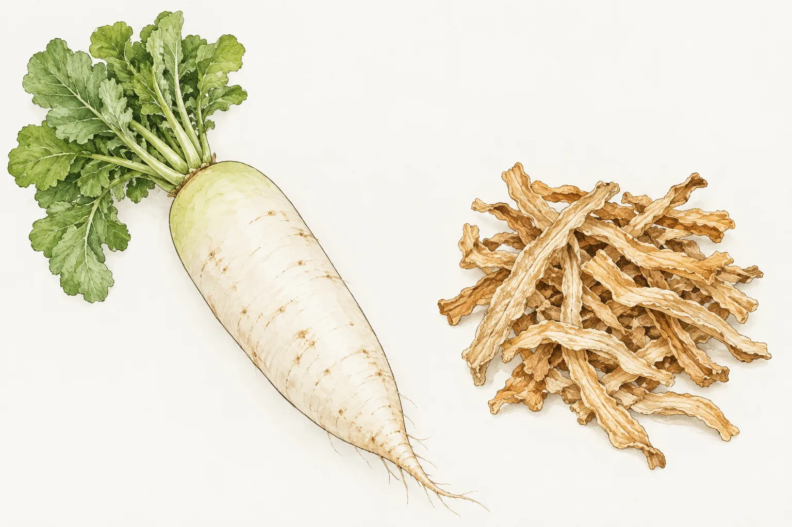
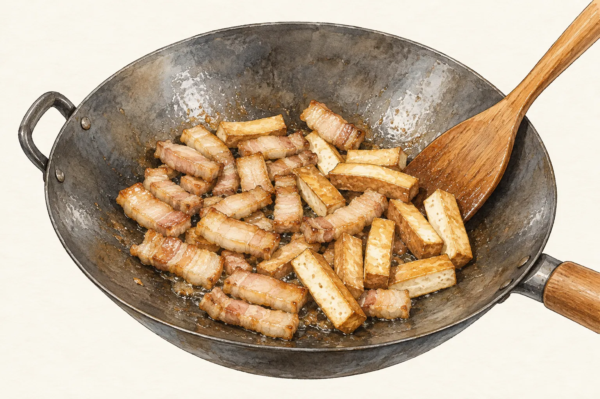
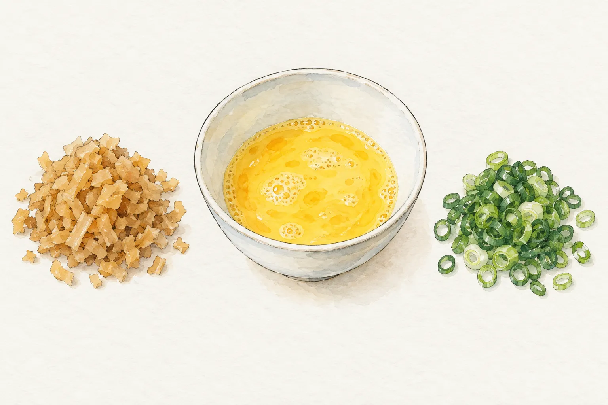

客家小炒裡的肉、魷魚與豆干，菜脯蛋裡細碎的蘿蔔乾，都讓人想到配飯的鹹香。從這兩道菜看客家飲食，可以同時看到食物保存、備料與炒菜的安排。採買回來的乾貨要先處理，幾樣材料也各有下鍋順序。

「鹹、香、肥」是常見的傳統風味描述。客委會客家雲的文化文章把它放在早期勞動、米飯與食物保存的背景下，也記下不同地方發展出的菜色。閱讀這段歷史時，仍要保留地區和年代；今天每個家庭怎麼吃，無法只靠三個字概括。

## 從菜田到菜脯，保存食有不同去處

客委會《食食客客》介紹菜包時，提到稻米收成後換耕蘿蔔的農作安排。蘿蔔除了鮮食，多出的部分曬乾後留作配料，也能與香菇、絞肉組成菜包餡。保存下來的食材，後續可以分配給不同料理。

地方記錄讓這件事更具體。客家文化資產數位網訪問大溪南興里的陳鍾明，記下他家在二期稻收後種白蘿蔔，拿來做菜頭粄，也留一部分製成菜脯。這是一戶農家的種植與料理經驗，不能直接套成每個客庄的固定年曆。封面以蘿蔔菜田點題，沒有重現某一處真實農場。

教育部臺灣客語辭典將「菜脯」釋為蘿蔔乾。國史館臺灣文獻館的菜脯甕條目，則記錄蘿蔔經日曬、灑鹽等加工後，放入甕罐的用途。這些資料可用來認識食材與器物；醃製要用多少鹽、如何控制衛生及能存放多久，並非這篇文章提供的操作指引。

準備煮菜時，先分清手上的東西。鮮蘿蔔、整條菜脯和已切碎的菜脯，進入配方前的處理不同。要做煎蛋，就回到所選菜譜，看它要求的是菜脯丁、菜脯碎，還是另切成所需形狀；不要把一張蘿蔔乾照片當作完整備料說明。

## 客家小炒的版本，從材料表就有差別

新北市客家文化典藏記述客家小炒又稱炒肉，並介紹祭拜後的豬肉搭配乾魷魚、豆干重新料理的說法。這讓人看到食材繼續被運用的餐桌脈絡。文化記錄提供的是一種由來敘述，不能據此指定所有家庭都得用同一份材料表。

具名食譜也看得到差異。阿基師在《型男大主廚》的示範用了五花肉、豆干、魷魚與蒜苗；高鋼輝在龜甲萬的版本則有肉絲、魷魚、韭菜與芹菜，材料表沒有豆干。本站整理的版本另有蝦米。翻開配方，先認出這些差別，就不會一邊照甲版本採買，一邊照乙版本開火。

本文比較示範中的安排，連結則通往本站既有菜譜。各版本保留自己的調味和工序，沒有合併成一份新的比例。高鋼輝用的是醬油膏，阿基師的示範則列醬油，本站兩者都有。買調味料時也要對照品名，不能只看瓶裡顏色相近就當成同一項。

## 肉與豆干先炒，魷魚照版本預處理

阿基師的示範先把五花肉下鍋煸炒，再接著炒豆干，魷魚排在後面。這個版本的乾魷魚事先泡水，再加米酒蒸軟；中途還會加高湯等液體燜煮，略收汁後才加入芹菜、辣椒和蒜苗。可見「小炒」這個菜名，本身沒有交代所有備料與加水方式。

高鋼輝則把魷魚絲先炸過，肉絲另外炒香，之後才與辛香料、蔬菜合在一起炒。兩份示範對魷魚的前置處理不同，不能只拿其中一份的最後一道翻炒，代替另一份從乾貨開始的完整過程。

本站的[客家小炒](/recipes/hakka-stir-fry/)把泡乾魷魚的時間算在整體準備裡，適合先看過材料再安排開火。它從肉條和豆干開始，接著加入魷魚與蝦米；蔥、蒜苗的白色部分和綠色部分也分開使用。照這個版本備料，可以依先後順序分放，炒鍋裡還只有肉與豆干時，後面要用的材料仍留在旁邊。

看完食譜若發現家裡缺少某項材料，可以另選備料較合適的版本。不要只刪掉預處理，再沿用原來的烹調時間；原示範中的時間是連著前面的食材狀態使用的。

## 菜脯入蛋，先看切法與處理方式

菜脯蛋讓保存食進入另一種日常料理。欣葉台菜對自家菜脯蛋的介紹，特別談到菜脯去鹽程度與切碎後的嚼感。這是餐廳對成品的要求，也提醒讀者，買到菜脯後還有處理這一步，不能把所有產品當成味道和粗細完全相同。

食譜自由配由阿全師、林昕志示範的版本，先把洗過的菜脯、蔥花及太白粉拌進蛋液，再進鍋烹調。本站整理的版本沒有太白粉，菜脯則先在無油鍋裡處理水分，才拌進蛋液。兩者材料與順序不同，照其中一份完整做即可，不必順手把另一份的粉量加進去。

準備本站的[菜脯蛋](/recipes/preserved-radish-omelette/)，可先把菜脯和蔥花放在不同位置，蛋打散後再按步驟混合。菜脯是切碎的配料，蛋液是煎成整片的主體；圖中分開呈現兩者與蔥花，方便對照各自的準備狀態，並未表示固定的份量比例。

想安排一頓家常飯，時間也要連備料一起看。有空預先處理乾貨，可以選客家小炒；手邊已有適合的菜脯和雞蛋，可從菜脯蛋開始。決定後打開相應菜譜，把材料用量與步驟放在一起讀，依那一份做法準備。
