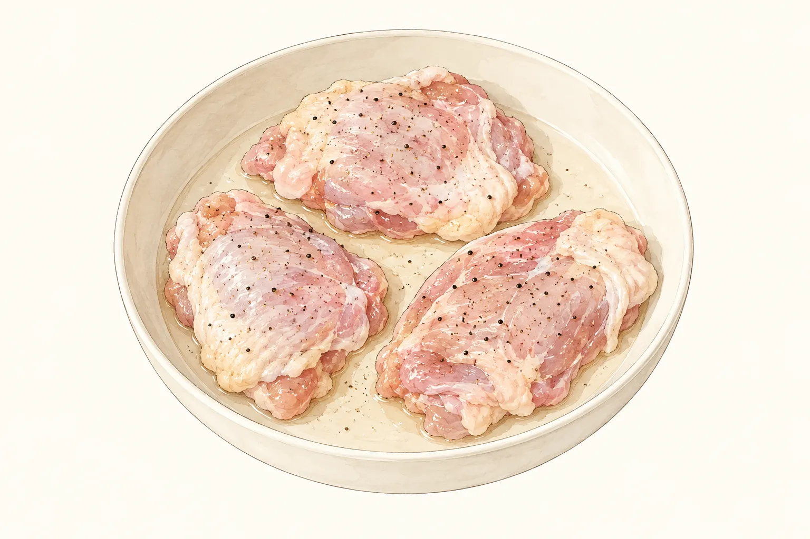
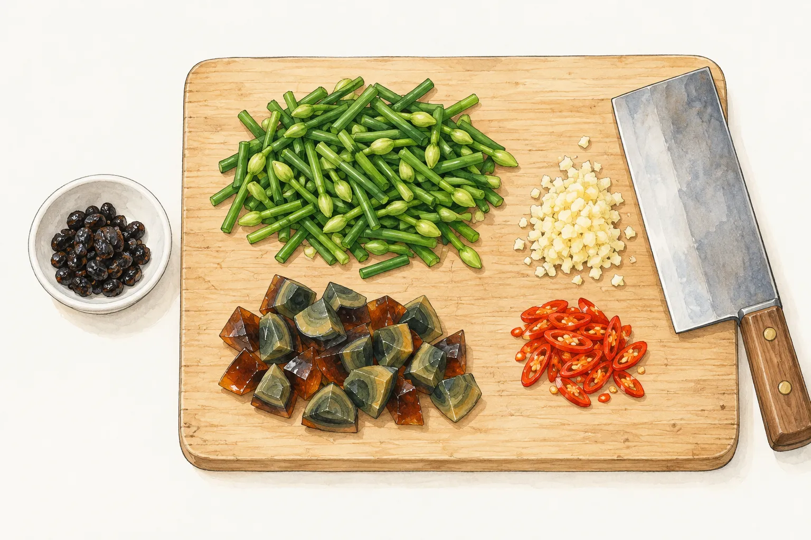
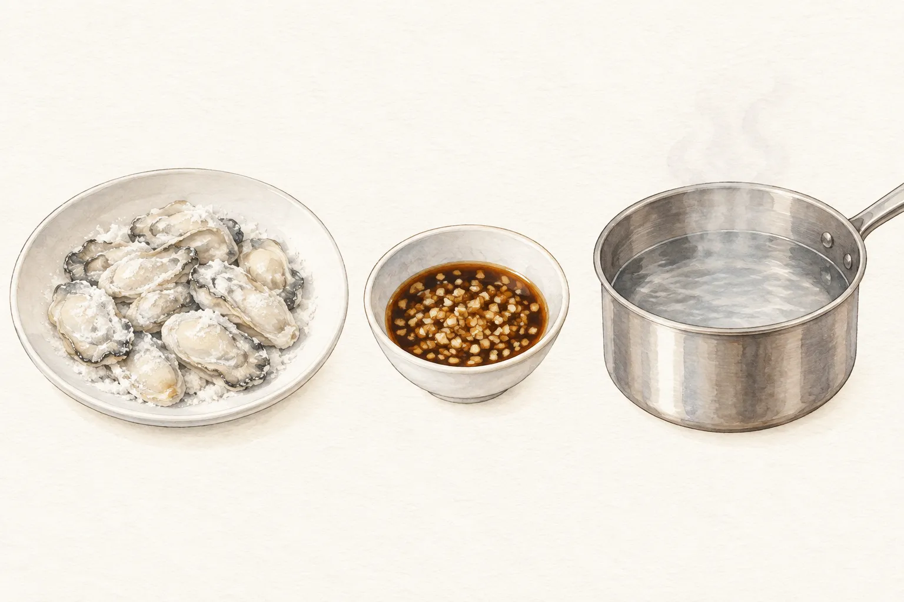

雞腿排在平底鍋裡煎，蒼蠅頭要用炒鍋，蒜泥蚵仔則靠一鍋熱水完成加熱。把這三道排進家裡的熱炒菜單，流理臺上會同時出現生肉、切好的細料和調醬的小碗。只有一個爐口時，可以先把不用開火的工作做完，再依要吃的菜換鍋。

這份菜單有整片雞腿排、切成小段的韭菜花和裹粉蚵仔，食材形態與上爐方式各不相同。想吃煎得金黃的雞皮，要先留醃漬時間；也可以只選兩道，分道上桌。三道都是選項，不必為了湊滿一桌，讓每只鍋都在等空位。

## 雞腿排先醃，煎的時候留在爐邊

雞腿排的準備從冷藏醃漬開始。本站的香煎椒鹽雞腿排使用帶皮去骨雞腿排，以米酒、鹽和黑胡椒粉調味；醃漬需要一至兩小時。這段等待不占爐口，可以另外安排洗菜、切料和調醬。生雞肉留在冰箱醃，處理過它的容器與工具洗淨後再作別用，上桌的熟食另拿乾淨盤子裝。

Carol 的鑄鐵鍋版本讓雞皮先接觸鍋底，等油脂釋出，再隔著防沾烘焙紙壓重，以中小火加熱。紙和重物要先備好，才不必在雞排下鍋後翻找。原配方的六至七分鐘是這一段的時間，拿掉重物後，還要等皮面金黃、能離開鍋底，再翻面繼續煎。

雞皮顏色是翻面的線索，雞肉內部熟度則用食物溫度計確認。FoodSafety.gov 的禽肉安全最低內部溫度為 74°C，探針要量在雞腿肉最厚的部位。雞腿排厚薄、鍋子與爐火都會影響加熱，另一面的時間要留給實際測溫判斷。選這道菜時，應把煎製與確認熟度當成一段需要照看的工作，不在壓重後轉身去處理另一道生鮮。

完整配料與鑄鐵鍋的操作順序見[香煎椒鹽雞腿排](/recipes/salt-pepper-chicken-thigh/)。

## 蒼蠅頭的細料在開火前備齊

蒼蠅頭的備料多在砧板上。本站這份配方有韭菜花、豬絞肉、豆豉和皮蛋，還要準備蒜末與辣椒片。韭菜花切小段，皮蛋切丁，豆豉完成浸泡後瀝乾，各自放好；調味料也先取出。炒鍋一熱，就能照配方往下接，不必讓絞肉留在鍋裡等切菜。

同樣叫蒼蠅頭，配方並不只有一種。台視《美食好簡單》的川味版本使用薑末與辣豆瓣醬，沒有皮蛋；它先處理絞肉和辛香料，韭菜花在後段加入。本站則是皮蛋版，先把絞肉炒散，再接韭菜花等材料。買菜前選定版本，蒜、薑、皮蛋與調味料才不會買到一半又換了一份做法。

準備完成時，可以核對砧板和小碗裡是否已有每一樣要下鍋的材料。這道菜用的是切細的韭菜花，雞腿排則要整片煎製，兩者所需的工作位置不同。先把砧板上的切配結束，清理好工作面，再開始照看鍋子，做菜時需要往返的地方就少一處。

本站[蒼蠅頭](/recipes/fly-head-stir-fry/)列有皮蛋版的完整材料與下鍋次序，調味沿用同一份配方。

## 蒜泥蚵仔留給煮水鍋，醬汁另外拌

蒜泥蚵仔用到的是煮水鍋。本站版本把蚵仔裹粗地瓜粉，煮熟後盛到九層塔上，再淋蒜泥醬油汁；蒜泥、醬油和其餘調味料可以先在小碗裡拌好。這樣安排時，炒鍋與煮水鍋各有用途，一個爐口也得預留放置另一只鍋的位置。

三立《型男大主廚》阿基師示範的蒜泥鮮蚵，也把調醬與水鍋加熱分開，不過搭配的是冬粉，粉料和醬汁內容都與本站不同。看不同食譜時，可以比較需要哪些器材；真正煮的時候，裹粉、加熱和盛盤仍照選定的那一份做完，不能把另一份食譜的短時間加熱直接接過來。

準備淋醬的小碗、盛熟蚵仔的盤子，與裝生蚵仔的容器分開。完成加熱後，用乾淨工具盛盤，再加上已調好的醬汁。蚵仔這道收尾在盤裡，蒼蠅頭則要在炒鍋內把材料與調味炒勻，兩者的備料終點不同，排菜單時可以先把這些容器攤開核對。

想做九層塔墊底的版本，可接著看[蒜泥蚵仔](/recipes/garlic-oysters/)。只有一個爐口而又想同餐吃到幾道熱菜，可以分道完成、陸續上桌；沒有適當保溫安排時，就減少道數，讓煮好的一道先吃。

## 下鍋前，把份量和鍋子對一遍

本站三份菜譜標示的份量不同：雞腿排是四人份，蒼蠅頭是三人份，蒜泥蚵仔是兩人份。選好菜以後，先依同桌人數查看各自的材料表，再決定要準備幾道。不能把「各做一份」直接當成同一組人數的套餐；若只煮兩道，也可以從喜歡的主料開始選，再核對家裡現有的鍋。

器材可以按三道菜分開放。雞腿排這邊是鑄鐵鍋、烘焙紙和壓重，蒼蠅頭這邊是炒鍋與已分好的細料，蚵仔這邊是煮水鍋、粉料和醬碗。爐口只有一個，待用的鍋仍需要安置處；冷藏中的生鮮等到要處理時再拿出來，盛熟食的乾淨盤子則先留出位置。

決定先吃哪一道後，就先完成那道菜的切配、調味與器材準備，再開火。雞腿排若還在冷藏醃漬，可以先做別道；已經開始煎，就把翻面和測溫做完。蒼蠅頭與蚵仔依各自配方接續完成，上桌次序隨當天選菜調整。
