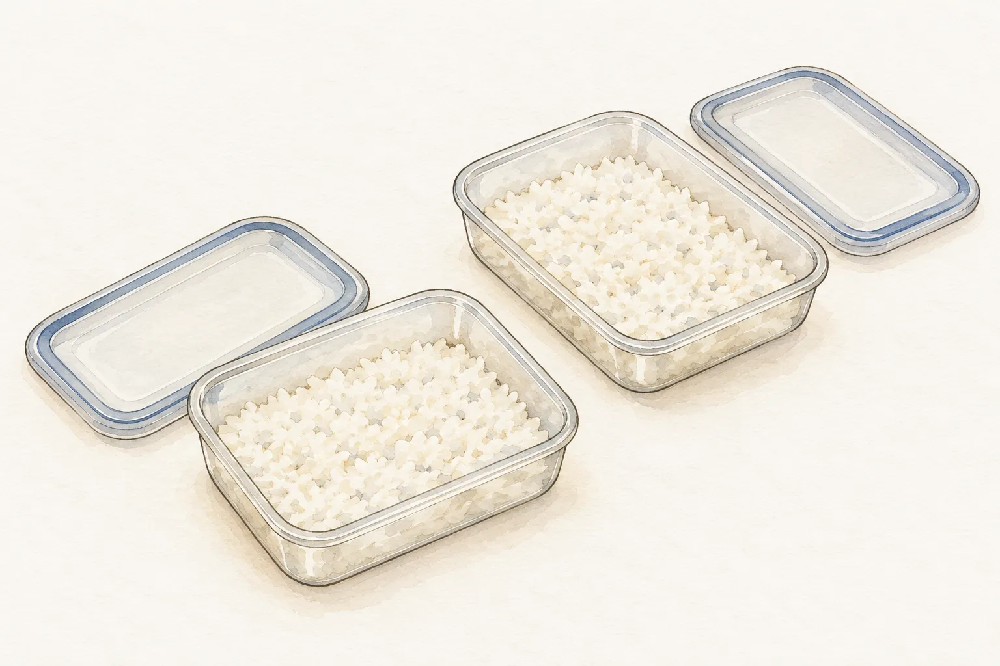
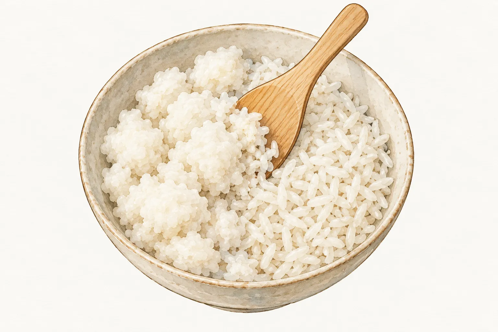
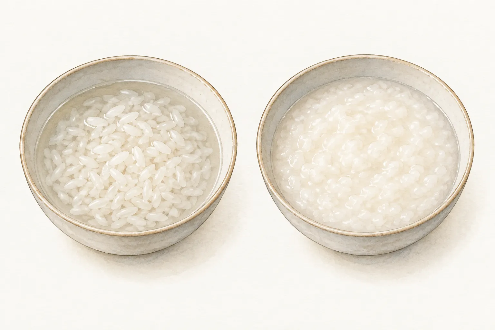

晚餐多煮的白飯，下一餐可以炒成飯，也能加湯煮粥。選做法之前，要先知道這份飯煮好後放在哪裡、多久才冷藏。廚房裡看起來同樣的一碗白飯，保存經過可能差很多；「昨天煮的」只交代日期，沒有交代能不能繼續吃。

這篇從家裡留下的熟白飯談起。飯粒要炒得分開，或煮到軟化、和湯融合，是兩種不同的料理安排。配方寫生米時，也不能直接把等量剩飯倒進去。先把這幾件事分清楚，再挑一份材料和工序完整的菜譜。

## 要留下的飯，分裝後盡快冷卻

食藥署的仙人掌桿菌資料提醒，芽孢能耐熱，熟食在室溫擱置太久，仍可能讓細菌生長。受污染的食物也可能看不出異常，因此不能把聞一聞、看顏色當成安全確認。若已出現異味或黏稠等變化，更不應繼續食用。

準備留到下一餐的部分，可以分成小份處理。英國食品標準局的家庭米飯指引建議盡快冷卻，理想上在一小時內完成，並提醒不要把飯留在飯鍋裡慢慢放涼。該指引也建議冷藏後於 24 小時內食用，且只重新加熱一次。這些是英國食品標準局針對熟飯的家庭處理建議，不是臺灣法規。

圖中的小份容器是快速冷卻的準備。食藥署的仙人掌桿菌預防資料，以 5°C 以下冷藏作為兩天內的短期保存方式，超過兩天則建議冷凍。兩個機構的保存期限不同；本文談的是剩飯，採英國食品標準局較保守的 24 小時安排。若預計吃不完，應在煮好後就儘早分裝、快速冷卻並冷凍，不等到冷藏期限快到才處理。要安排明天的餐點，可以在容器註記煮好與冷藏的時間，方便家人辨認。若不確定是否曾在室溫放太久，保守做法是不要留作下一餐。

## 再炒一次，不能補救保存不當

食藥署 2026 年 7 月的隔餐飯菜提醒指出，飯菜在室溫久放、超過兩小時未冷藏，可能讓細菌繁殖並產生毒素。部分毒素耐熱，後來再熱仍有風險。因此，決定做炒飯或粥之前，就要先完成保存判斷，不能把「等等會大火炒」當作放行理由。

這也適用於把冷飯倒進沸湯的做法。改變菜名、增加煮的時間，都沒有把之前的保存過程歸零。若飯是妥善冷卻、冷藏留下的，再依所選菜譜完整加熱。食藥署這篇隔餐飯菜提醒建議，再食用前讓食物中心溫度超過 70°C；可以用食品溫度計確認，而非只摸容器外側。這項再熱要求仍以保存妥當為前提。若已在室溫放過夜，就不要靠煮粥來挽救。

保存和口感分開看，選菜才不會混亂。飯粒偏濕、容易成團，是處理質地的問題；久放未冷藏，是能否使用的問題。前者可以回到配方調整操作，後者不能用調味或延長烹煮掩蓋。

## 炒飯看表面水氣，也要先把飯團鬆開

隔夜飯並非炒飯的必要條件。J. Kenji López-Alt 在 Serious Eats 的比較中，現煮飯攤開、散去表面水氣後也能炒；冷飯則先拆開結團，再分批入鍋，避免一次塞太多。這是他的料理比較，並非量出所有隔夜飯含水率的研究。

拿到一份菜譜，可以先看它從哪種飯開始。寫「冷飯」的版本，備料時就要有安全冷藏的飯；寫「現煮飯」的版本，則把散去水氣的操作也算進去。不要只看最後盛盤的照片，就省掉前面的處理。

本站的[蛋炒飯](/recipes/egg-fried-rice/)用熟白飯，先把結塊稍微壓開，再接上炒蛋和下飯的順序。想練習時，可以先選這種材料較單純的版本，核對飯量、雞蛋與調味料後再開火。先把要用的份量取出，其他留存的飯繼續按保存安排處理，避免為了備料把全部冷飯長時間放在檯面。

## 煮粥先認清材料寫的是白飯還是生米

熟白飯可以用來煮粥；選配方時，不宜只把生米換成等量熟飯，其餘水量卻原封不動照用。兩份配方即使都寫「一杯」，也可能一份是量生米，另一份是量已煮熟的飯；使用米杯或一般量杯，容量又可能不同。讀材料表時，要連同米飯狀態、量具與液體種類一起看。

Isa 媽媽的小廚房的香菇雞肉粥，就是把熟白飯加入已放入香菇、雞肉的湯裡，繼續煮到濃稠。本站的[香菇雞肉粥](/recipes/shiitake-chicken-congee/)沿用熟飯這條做法，材料表也明寫白飯是在煮熟後量取。這篇只比較起點，不把它的用水量推成所有剩飯都適用的比例。

Made With Lau 的雞粥則以生米做出較滑順的口感。作者在問答中說熟飯也能使用，但較容易成團。那是該版本想做出的質地，不能延伸成「剩飯不能煮粥」。挑配方時，先選熟飯版或生米版，再依同一份做法往下走，省得一邊使用剩飯，一邊等待生米配方描述的變化。

## 想保留飯粒，可以選湯飯的方向

湯飯和濃粥的目標口感有差別。Just One Cookbook 的日式雜炊使用熟短粒米，作者會把冷飯沖洗、瀝乾，以減少多餘澱粉，讓湯較清爽；現煮飯則可以略過沖洗。這是該道雜炊的安排，不是所有粥都要把飯拿去沖水。

圖中左側仍看得到清楚飯粒，右側的湯體則較濃，閱讀配方時也可以留意它描述的是哪一種狀態。若想吃湯和飯粒都清楚的口感，可以找熟飯湯飯的做法；若想要較濃稠的粥，就選明寫煮到濃稠的版本。兩者都先使用保存妥當的飯，肉類與其他配料也照各自菜譜處理到熟，不能只看到湯滾了就略過配料的熟度確認。
