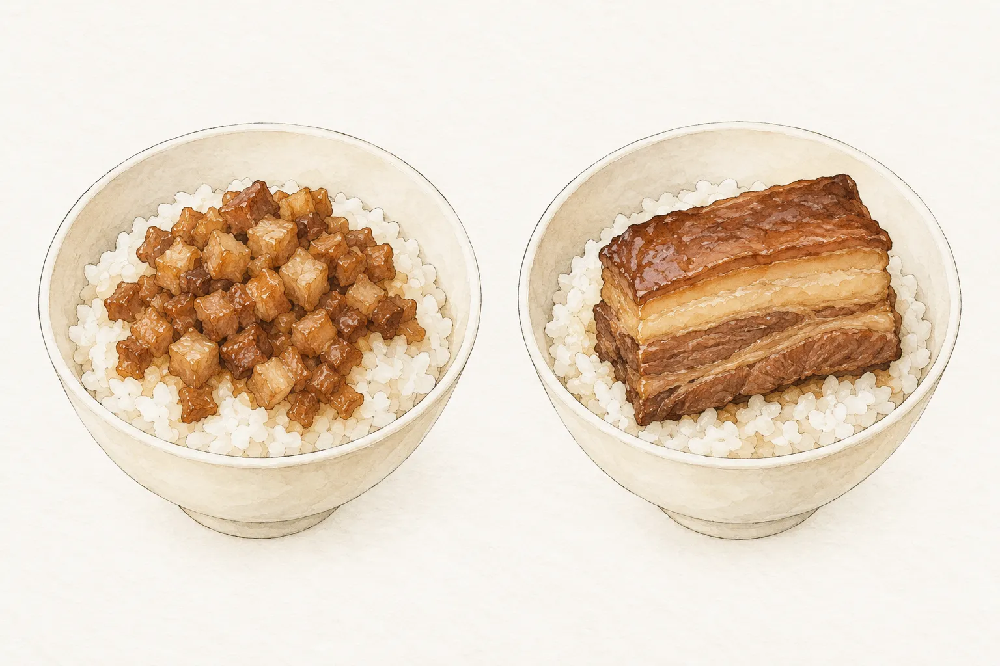
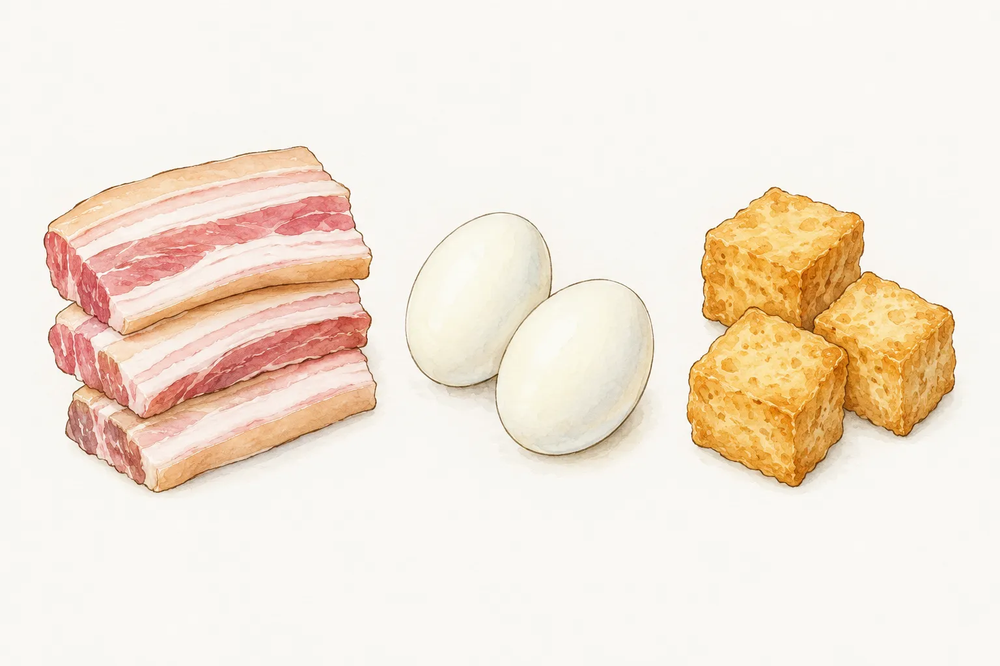
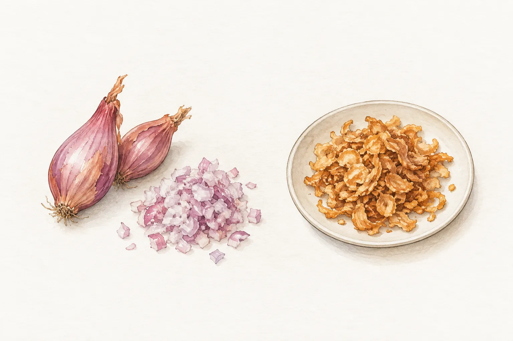

今晚想端出一鍋五花肉，讓人夾肉、滷蛋和油豆腐配飯，可以選本站的台式滷肉；想把肉醬淋在意麵上，拌開就能吃，則可以選肉燥麵。兩份配方都用豬肉與醬油，肉的形態、配料和上桌方式不同。先決定主食怎麼吃，再買肉和辛香料，比站在肉攤前才想菜名容易安排。

走進小吃店，菜單上的「滷肉飯」又未必是家裡想像的那一碗。從稱呼回到碗裡的肉，再讀配方的材料，就能分清今晚要煮的是哪一種。

## 點滷肉飯時，多看一眼肉的模樣

農業部的食農教育資料記錄了滷肉飯、肉燥飯和焢肉飯的地域用語差異：北部常稱滷肉飯的碎肉拌飯，在中南部也會叫肉燥飯；南部所稱的滷肉飯，則可能是一塊三層肉配飯。點餐時看看成品照片，或問一句是肉塊還是碎肉，比單靠名稱更能確認自己想吃的樣子。這些稱呼是地方飲食用語，不能用來規定每一家店都得怎麼切肉。

肉燥也不限於絞肉。龜甲萬刊載、由 One Life 煮婦團研發的手切滷肉燥，使用五花肉，煮過後切成長條，再加入調味燉煮。配方裡還有油蔥酥、蝦米與八角。這份例子保留了手切肉條的形態，與本站肉燥麵的絞肉不同；兩者都叫肉燥，採買時卻不能只向肉攤說「要做肉燥的肉」。

讀食譜時，把肉的部位和形態一起看：五花肉是材料名稱，厚片、長條或絞肉則說明它進鍋前的樣子。本文比較的是本站兩份家常配方，並不把其中一份當成各地共同的標準。

## 要一鍋配菜，選厚片五花肉的版本

本站[台式滷肉](/recipes/braised-pork-belly/)把五花肉切成厚片，和完整的水煮蛋、油豆腐一起滷。這些材料都能各自夾取，適合放在餐桌上配白飯。五花肉的肥瘦層次仍看得見，蛋和豆腐也有自己的形狀，與細碎肉醬拌進主食的吃法不同。

這份食譜標示六人份，材料表有一千兩百公克五花肉、六顆水煮蛋和三百公克油豆腐。安排一桌飯菜時，可以先確認這鍋的份量，再決定還要準備哪些菜。用餐人數較少，便依食譜份數調整整份材料；蛋和豆腐也要一起計算，不能只減豬肉，卻仍沿用整鍋的調味量。

辛香料方面，這鍋用青蔥段、薑片、去皮大蒜和辣椒，另有滷包。它沒有列肉燥麵使用的紅蔥頭，兩道菜的蔥香來源不同。想在同一鍋裡吃到肉、蛋與豆腐時，這些完整的配料正是挑選這份版本的理由，不必再把它改造成細碎肉醬。

同名食譜仍可能採不同做法。龜甲萬的台式滷肉先處理糖，再把肉片兩面煎出金黃色，調味中使用紹興酒與紅米；本站連結的版本則包含蛋、油豆腐與滷包。選定一份後，沿用它的材料與操作順序即可，不把兩份的炒糖、酒量與滷汁拆開拼湊。

## 要拌麵肉醬，分清紅蔥頭和油蔥酥

本站[肉燥麵](/recipes/minced-pork-noodles/)標示兩人份，以一百三十公克豬絞肉搭配一百七十公克意麵。這裡的肉是麵上的醬料，份量也連著麵一起安排；台式滷肉的五花肉則是能單獨夾取的一道配菜。比較兩份購物清單時，要連主食一起看，不能只拿肉重判斷哪一道比較適合幾個人。

肉燥麵材料表列的是切末的紅蔥頭與大蒜；前面提到的手切滷肉燥範例，使用的則是油蔥酥。新鮮紅蔥頭與現成油蔥酥在採買時就要分開辨認。本站肉燥麵從新鮮紅蔥頭備起，兩份配方用的是不同材料，採買時照各自清單準備。

這份肉燥麵另有高湯，調味用五香粉與胡椒粉，並搭配醬油、醬油膏和米酒。它沒有台式滷肉的蛋、油豆腐與滷包，準備工作集中在肉醬和麵條。想做乾拌麵，便可以直接從這份材料表開始；想吃手切五花肉的肉燥，就要回到手切版本，連蝦米、八角等配料一併考慮。

## 決定主食後，再選今天的份量

肉燥在臺南的小吃裡有很多去處。臺南市政府觀光旅遊局整理肉燥美食時，列出的品項包括米糕、碗粿、意麵和擔仔麵。肉燥既能淋飯，也能搭麵和米食，各店又有自己的配方。把它放在不同主食上，是當地飲食裡常見的用法，不代表每一道都用相同的肉醬。

在家可以把選擇縮小到這一餐。白飯已經安排好，想另有一鍋肉、蛋與豆腐，就打開台式滷肉的六人份材料表，按人數調整。今天想吃乾拌麵，則從肉燥麵的兩人份往上或往下安排；煮麵時依包裝標示處理，肉醬完成後再淋上。

多人吃飯也能選麵，兩個人吃飯也能煮滷肉。先選夾著吃的配菜，或拌開吃的主食，再核對份數與家裡已有的材料。購物清單寫到這一步，就會清楚今天要帶回的是厚片五花肉、蛋和豆腐，還是絞肉、紅蔥頭與意麵。
