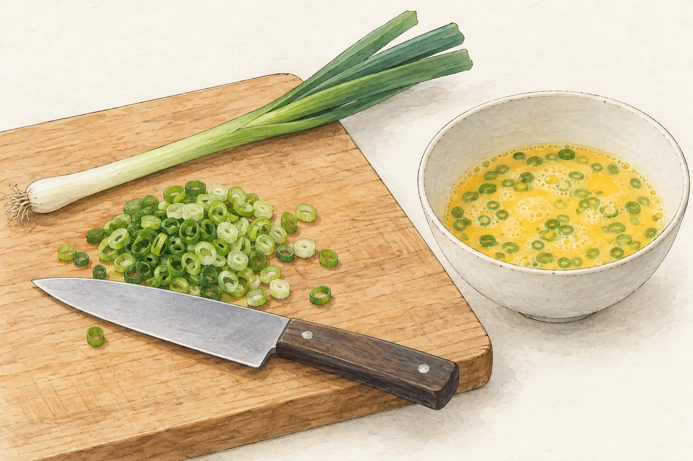
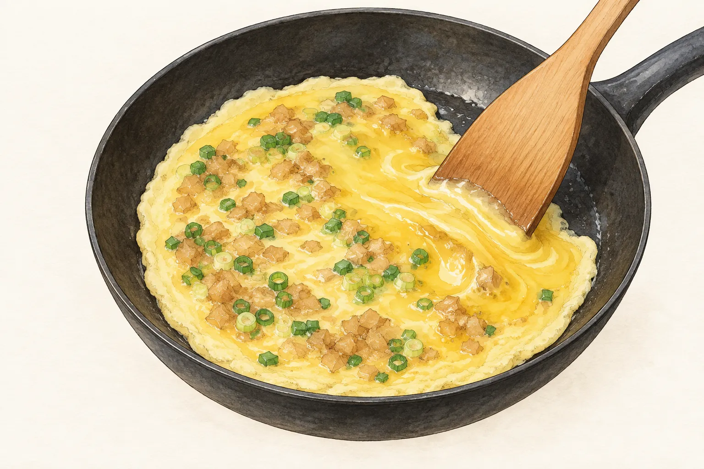
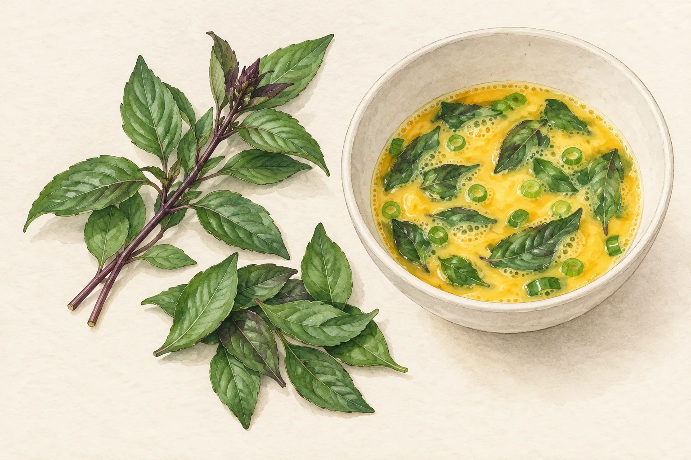

想煎一片完整的蛋，鍋鏟卻一伸進去就把它弄散；下一次多等一會兒，又擔心底下已經焦了。這時候最想問的，多半是「到底幾分鐘才能翻？」

先把計時器放在旁邊，看看自己要做哪一種蛋。蔥花蛋可以攤平，也可以捲起來；菜脯蛋有先炒配料的版本，也有直接拌進蛋液的做法；九層塔的香氣則要和火候一起照顧。以下選三份公開料理示範，沿著備料、成形、翻面的順序讀。要學的是看懂下一個動作需要什麼條件，時間仍留在各自的配方裡。

## 蛋液正在成形，鍋鏟先別急

蛋受熱後，蛋白質的結構會改變並逐漸連結，原本流動的蛋液才形成能承托配料的結構。Exploratorium 的料理科學說明也提醒，長時間高溫加熱會讓蛋白變得有韌性。對想保留柔嫩口感的人來說，一味加大火並不能解決所有等待。

料理示範中的「靜置」與「輕推」看似相反，其實各有目的：要捲成蛋卷，必須先讓蛋形成連續的一片；較厚的菜脯蛋，示範者則會處理仍集中在中央的蛋液。先認清正在做什麼，再決定鍋鏟要不要動，才能避免一邊想保留整片、一邊又把它當炒蛋攪開。

這裡的成形只是在說明操作條件。蛋看起來能翻面，仍不代表中央已經完成烹煮；最後的熟度要另外確認。

## 蔥花蛋：先決定要攤平，還是捲起來

青蔥處理好再打蛋，動作會比較從容。江玉美示範的蔥花蛋卷，先將蔥切細，再與蛋及鹽拌合。配料在倒入鍋前已分散開，就不需要一邊煎、一邊追著某一團蔥花攪動。

這份示範用五顆蛋，以中火讓蛋液先靜置約三分鐘，接著才從一側捲起。它特別提醒，尚未充分受熱便攪動，蛋容易破裂。值得帶走的是動作順序：先等成片，再開始捲；不是把「三分鐘」當成任何鍋子、任何蛋量都適用的口令。

站內的[蔥花蛋](/recipes/scallion-omelette/)是另一份攤平翻面的做法，並非這份蛋卷。若今天想做的是平面煎蛋，就依那份菜譜操作，不必為了套用蛋卷的秒數而增加蛋量或改成捲蛋。選定成品形狀之後，再讀火候和動作，食譜才不會讀到一半變成另一道菜。

## 菜脯蛋：留意中央，別只盯著邊緣

菜脯帶來的是切碎的配料，進鍋之前還有處理方式要選。阿全師與林昕志的示範將菜脯洗淨，加入蛋、蔥花及少量太白粉拌勻。太白粉是這份配方的一部分；不能因為看到它，就推論所有菜脯蛋少了粉都煎不成。

蛋液入熱鍋後，這份做法把火轉小。接著的細節比「煎到金黃」更值得看：中央較厚、仍流動的蛋液，會用筷子或鍋鏟輕輕往外帶，再進行翻面。操作的目標不是將整鍋炒散，而是照顧中央與周邊不同的狀態。

插畫停在中途，中央的光澤不是成品建議。看到外圈已經凝住，仍要回頭看中央，不能只憑邊緣顏色便盛盤。這份示範也提出用盤子協助翻面的方式；那是另一種操作選擇，不必把整片蛋拋起來才算成功。

站內[菜脯蛋](/recipes/preserved-radish-omelette/)採先將菜脯炒乾、再與蛋液混合的路線，沒有沿用這份加太白粉的組合。兩份可以比較，實際動手時請選定其中一份，將配料處理到翻面的步驟一起讀完。只抽出「轉小火」三個字，便會漏掉前面已經做過的事。

## 九層塔蛋：香草先備好，火別一路開大

農業部兒童網的九層塔煎蛋示範，先洗九層塔、切蔥，再和蛋及鹽拌勻。流程把備料放在開煎之前，進鍋後便能專心看蛋的變化，不必轉身找香草或調味料。

這份做法直接提醒火不要太大，並在烹煮中翻面以免燒焦；胡椒粉則不要蓋過九層塔的味道。它沒有提供通用的翻面秒數，也沒有量出一個適用所有平底鍋的油溫。本文因此不替它補上數字，更不從圖中的葉片數推算份量。

站內[九層塔煎蛋](/recipes/basil-omelette/)另有自己的材料比例與葉片處理方式。想從這道開始練習，可以在下鍋前把整份步驟讀一次，知道什麼時候要翻面、什麼時候才算完成，便不會把注意力全放在第一面是否上色。

## 翻面只是中途，最後確認整份蛋已熟

完整翻過去很有成就感，但還有另一面與中央要煮好。FoodSafety.gov 對混合蛋料理列出的安全中心溫度是攝氏七十一度；生蛋單獨烹調的指引則要求蛋白與蛋黃凝固。這是食安判準，不能用「兩面金黃」代替溫度量測。

下一次煎蛋，先做一個小決定：今天要練習的是整片成形、照顧較厚的中央，還是控制香草蛋的火候？選一份對應的完整配方，備好材料後再開火。記下鍋裡出現什麼變化時自己開始動鍋鏟，比只記「今天煎了三分鐘」更有用。

真正要帶回廚房的重點很簡單：動作跟著蛋的狀態走。需要成片時先等，需要處理中央蛋液時照示範輕推，翻面後再完成熟度確認。把這幾個關口看清楚，計時器才會成為輔助，而不必替你猜鍋裡發生了什麼。
