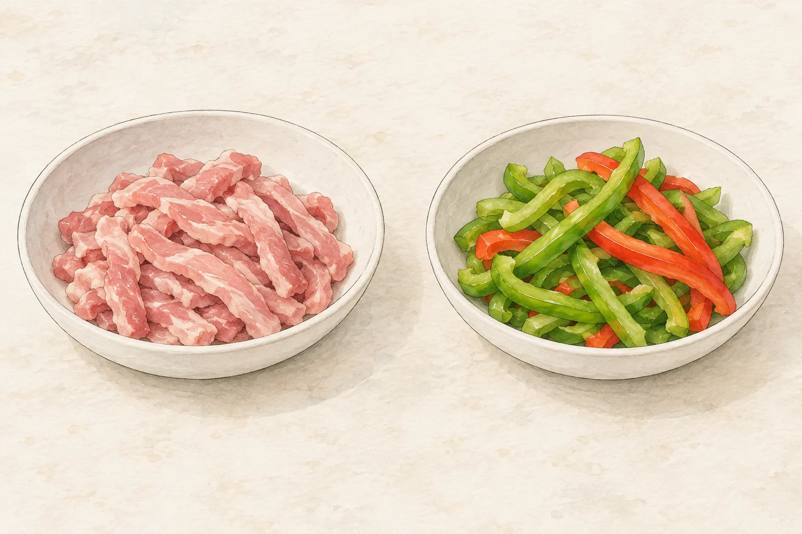
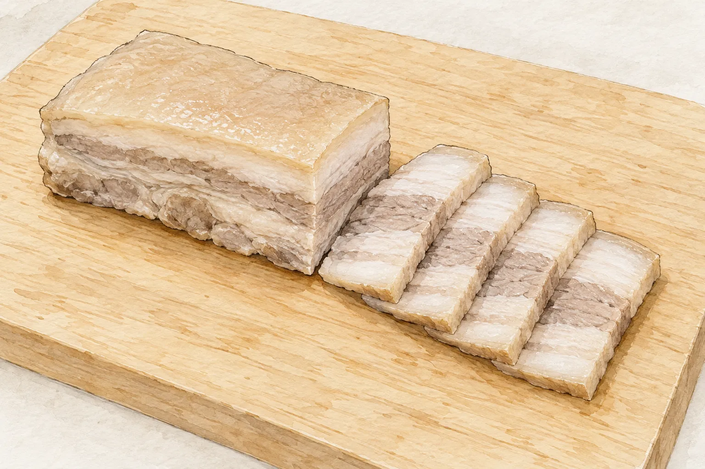
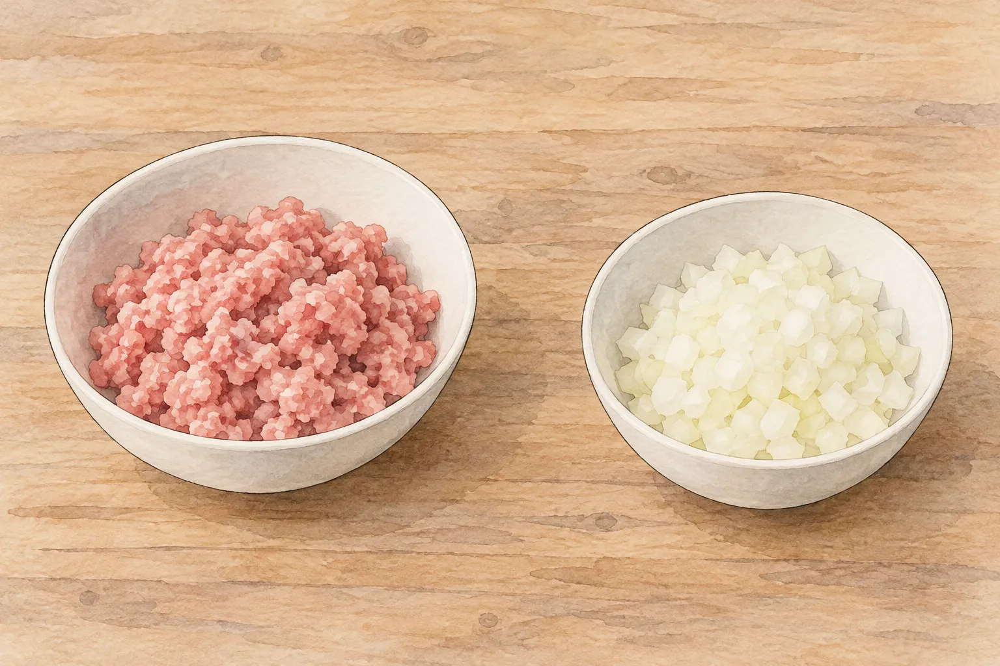

站在肉攤前說「我要一份豬肉」，接下來往往還有好幾個問題：要哪個部位？切片還是切絲？今天炒，還是整塊煮？原本只是想替晚餐添一道菜，卻在買肉時先卡住了。

回頭看今晚的菜名，事情會簡單一些。青椒炒肉絲要的是能和配菜一起入口的細條；蒜泥白肉會先處理整塊肉，再切成片；洋蔥炒豬絞肉則從鬆散的碎肉開始。三道都用豬肉，採買與下鍋前的準備卻不相同。先挑定一道，再問部位與切法，比買回同一塊肉後，臨時要求它兼任所有角色更容易安排。

## 部位和切法，分成兩件事問

里肌、梅花、五花是在說肉來自哪裡；肉絲、肉片、絞肉是在說它被處理成什麼樣子。知道包裝寫著「肉片」，仍未必知道裡面是哪個部位。

農業部食農教育資訊整合平臺的豬肉介紹，把大里肌、小里肌與五花分開說明。小里肌也叫腰內肉；五花來自腹部，有皮、脂肪與瘦肉的層次。這些差異在肉還沒切碎時比較容易辨認，切成同樣大小後，也不會因此變成相同的食材。

所以，向攤商提出的問題可以多一層：「這份肉絲是哪個部位切的？」接著才說要做哪一道菜。若菜譜已經指定五花，就先照那個選擇找；若只寫豬肉絲，也先保留這個差別，別自行認定作者一定用了腰內肉。

## 肉絲快炒，先選一份完整做法

想做[青椒炒肉絲](/recipes/green-pepper-pork/)，可以從站內這份配方開始。它採用豬里肌肉絲，但原始來源只寫了豬肉絲，里肌是本站補充的部位建議。這一點值得分清：拿這份菜譜去採買時有明確方向，卻不能反過來說所有青椒肉絲都必須使用同一部位。

這份站內做法先替肉絲調味，肉下鍋後再加入椒絲一起炒。材料表與步驟要一起讀：如果先把肉換成厚片，還沿用肉絲的動作，鍋裡處理的已不是原來那份配方。

另一個可比較的例子，是料理作者 Amanda 張采如的高麗菜肉片示範。她選胛心瘦肉，逆紋切成薄片或絲、薄薄裹粉，肉先炒起，再炒蔬菜，最後合在一起。這是她針對那道菜安排的順序，和站內青椒肉絲並不完全相同。

兩份示範放在一起，學到的是讀出「用了什麼肉、怎麼切、先炒什麼」，而不是拼出一個通用口訣。今天選青椒肉絲，就把它從材料到完成看完；改做高麗菜肉片時，再完整採用另一份做法。不要只抽走裹粉這一步，便以為其他安排都能照舊。

## 都叫肉片，先切與煮後切卻差很多

「幫我切薄一點」很適合用來說明某些快炒需求，卻未必適用今晚這份蒜泥白肉。站內[蒜泥白肉](/recipes/garlic-pork-slices/)使用五花肉，先整塊烹煮，之後才切片。若買來的已是一盒生薄片，前面的處理方式就需要另一份對應食譜，不能直接搬用整塊肉的時間。

五花本身的層次，也說明了為什麼不能只用「厚薄」來選肉。農業部的部位介紹指出，梅花位於肩胛上方，油脂分布較均勻；大里肌的油脂則較少。它們都可以被切成片，切面與脂肪分布仍有差異。本文不替不同部位排出好吃名次，先讓菜譜決定需要哪一種。

買菜前可以把需求說完整：「我要做這份蒜泥白肉，需要一塊五花，回家煮完再切。」這比只說要肉片多了一點資訊，卻能避免帶回與做法不合的形態。菜譜列出的加熱時間也只屬於那份條件；換了肉塊尺寸，不能把分鐘數當成已煮熟的保證。

## 絞肉看不出原形，更要問清楚原料

到了絞肉，部位問題並沒有消失，只是比較難從外觀辨認。農業部的豬肉資料列出前腿、後腿各自的加工用途；另一份梅花肉料理則把梅花剁成肉末。肉經過切碎或絞碎，仍然有原料上的選擇。

站內[洋蔥炒豬絞肉](/recipes/onion-minced-pork/)偏向使用較瘦的絞肉，並提出後腿的建議。採買時可以直接問是不是偏瘦、由什麼部位絞成；不需要為它臨時補出七比三、八比二之類，原配方沒有指定的脂瘦比例。

這道菜先處理洋蔥，再放絞肉炒散。與整塊白肉相比，準備形態、進鍋順序都換了；與肉絲相比，也不用追求保留細長的條狀。挑好一份配方之後，手上的動作才有明確目標。

絞肉的熟度另有需要確認的事。FoodSafety.gov 對豬絞肉列出的安全中心溫度是攝氏七十一度，並要求使用食物溫度計確認。這與站內洋蔥絞肉的提醒一致，不能拿「看起來變色了」代替量測。插畫只幫忙認識備料形態，沒有提供可用來判定熟度的顏色標準。

## 買肉之前，先把菜名寫下來

下次要做這三道菜，不妨先列一張很短的採買筆記：青椒肉絲對照那份配方的里肌建議；蒜泥白肉找適合整塊烹煮的五花；洋蔥絞肉確認原料與偏瘦需求。不同料理可能需要不同塊肉，不必為了「一次買齊」而強迫它們共用同一個部位。

真正值得記住的，是三個先後相連的問題：今晚煮什麼？那份菜譜用什麼肉？它在下鍋之前，是整塊、細條，還是已經絞碎？問完這三件事，再處理份量與調味，就比較不會回到家才發現，買到的肉與打算做的菜各走各的方向。

先選菜，再選肉，最後才決定怎麼切。把這個順序想清楚，肉攤前那句「我要一份豬肉」，就能變成一個對方聽得懂、自己也知道回家怎麼接下去的請求。
