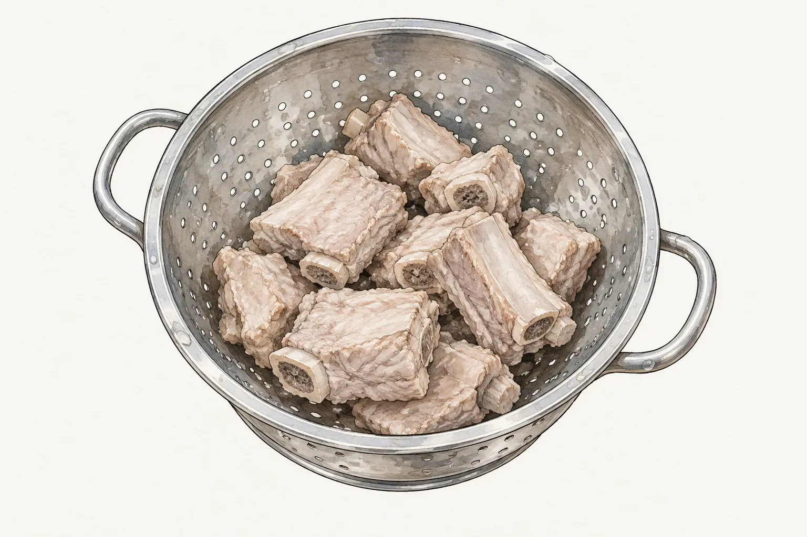
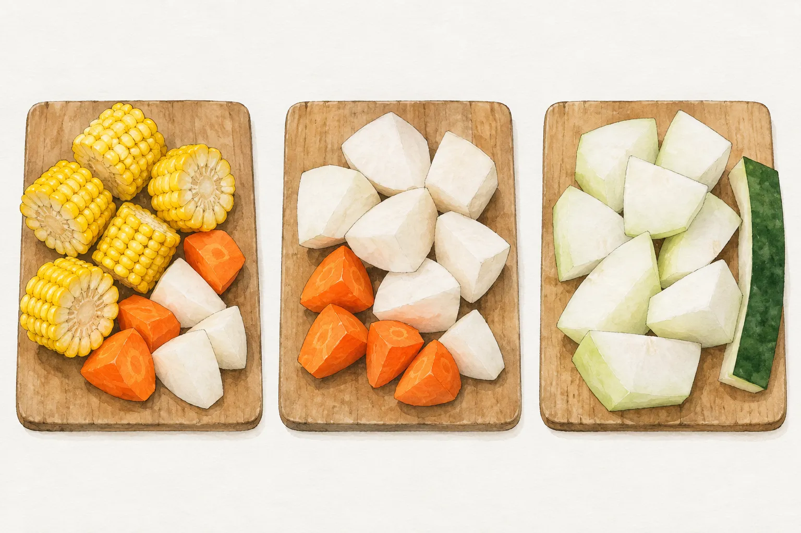
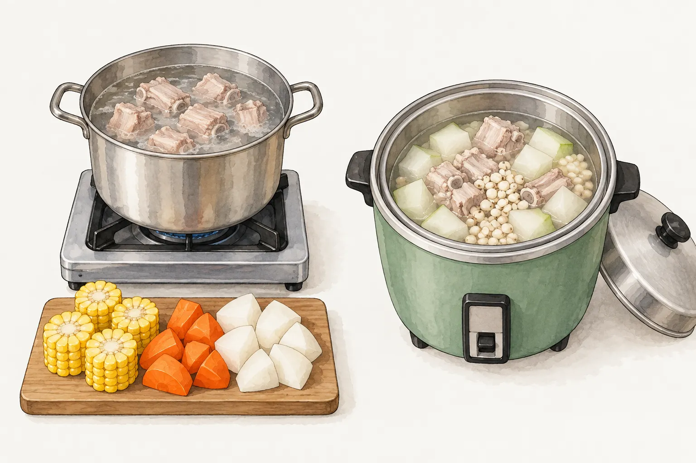

排骨已經買好了，配玉米、白蘿蔔，還是冬瓜？在家煮湯時，這常像是換一樣蔬菜的小決定。翻開食譜卻會發現，有的讓排骨先煮一段，有的把材料一起放進電鍋；連兩張都有白蘿蔔的配方，後段時間也不相同。

換配料時，值得一起帶走的是整張食譜的安排。以下從玉米與白蘿蔔兩份爐火配方，對照冬瓜的電鍋示範，看看哪些步驟可以互相理解，哪些數字要留在原來那鍋湯裡。

## 汆燙之後，還有一段正式烹煮

這幾份做法都先處理排骨，再開始煮湯。文芳示範的冬瓜湯把汆燙用途寫為去除雜質；味之素的兩份排骨湯也將它排在正式燉煮之前。若照這些食譜做，汆燙後撈起備用，接著才依配方另備湯水。食譜寫到「備用」，表示前處理完成，不能據此認定整塊排骨已經熟透。

料理前處理與食安要分清楚。美國農業部的食品安全資料提醒，沖洗生豬肉可能讓肉汁中的細菌濺到周圍，增加交叉污染；生肉不靠反覆沖洗來保證安全。處理生肉後，雙手與接觸面仍須清潔，後續烹煮也不能省略。圖中的灰白肉面只是在描述汆燙後的外觀，不是可以食用的判準。

這一節只釐清三份做法共同的起點，不把汆燙當作所有排骨料理都必須遵守的規則。沿著所選食譜往下讀，接下來才會遇到不同的下料安排。

## 玉米湯的兩段時間，連紅白蘿蔔一起看

[玉米排骨湯](/recipes/corn-pork-rib-soup/)裡除了玉米，還有紅蘿蔔與白蘿蔔。味之素原配方將排骨先燉三十分鐘，之後才放進這三種蔬菜，再燉三十分鐘。因此，準備材料時不能只記得買玉米；閱讀步驟時也不能把後半段的時間，算成整鍋湯從開始到完成的時間。

這種分段安排很適合拿來練習讀食譜。先找出第一段鍋裡有什麼，再看第二段增加什麼。第一段處理的是排骨與湯水，第二段才加入蔬菜。把分界看清楚，就不容易在一開始把所有材料倒進去，煮完才發現自己已經改了原來的流程。

圖中列的是三組配料外觀，不是可以照圖計數的材料表。實際份量、用水與調味仍以菜譜為準。這份玉米湯最後還有鰹魚風味調味料，不能只憑菜名便把湯的味道全部歸給玉米。若想調整調味，先知道原配方用了什麼，才看得出自己改動的地方。

## 白蘿蔔版本，後段多留了時間

另一份[白蘿蔔排骨湯](/recipes/radish-pork-rib-soup/)同樣先煮排骨，卻沒有照搬玉米湯的後半段。味之素這份做法是煮開後轉小火，排骨先煮三十分鐘，紅、白蘿蔔入鍋後再煮五十分鐘。兩段合起來已有八十分鐘，還沒算備料與汆燙。

原來源頁的時間標籤卻寫二十分鐘，與正文步驟不一致。安排晚餐時，應以逐步寫出的烹煮時間為依據，不把醒目的短標籤當成完整工時。這也是看食譜時很實用的一個檢查：把每段等待時間放在一起，確認它們是接續發生，還是可以同時進行。

兩份來源的用水、蔬菜份量與調味都有差別。單憑這兩張食譜，無法推論白蘿蔔一律要煮五十分鐘，也不能說另一份只煮三十分鐘就一定不足。這裡保留各自的條件，讓讀者選擇一份完整配方；若把其中一份的材料搭上另一份的時間，已經是在自行調整，不能再當成原食譜的結果。

## 冬瓜放進電鍋，採另一套安排

冬瓜也有從一開始就與排骨同煮的做法。文芳的公開料理示範使用冬瓜、先泡過的薏仁與汆燙排骨，一起放進容器，再交給電鍋蒸煮。示範中特別提到冬瓜煮後較軟爛。對這份湯來說，軟嫩是它接受的成品狀態，不能因為冬瓜沒有最後才下，就判定做法有問題。

這張圖右側包含薏仁，對應的是文芳的示範；站內[冬瓜排骨湯](/recipes/winter-melon-pork-rib-soup/)則是另一份不加薏仁的電鍋配方。若選用站內版本，請依該份菜譜的材料與用水，不要套入本段的薏仁示範。

使用電鍋還要辨清內、外鍋的水。內鍋的水是湯的一部分，外鍋的水供蒸煮使用；抄材料時若只寫「加水」，便少了重要位置。至於外鍋水量與爐上幾分鐘如何互換，本文沒有做這種換算。要煮哪一份，就連同該份的鍋具、下料與用水方式一起採用。

## 晚餐想煮哪鍋，先選一份完整做法

想練習爐上分段下料，可以從玉米版本開始，讀清楚排骨單獨燉煮與蔬菜加入的分界。選白蘿蔔版本，晚餐就要為較長的後段預留時間；偏好電鍋做法，則先確認手上的食譜寫的是哪組配料，以及內外鍋各自的水量。

下次換掉配料時，可以把原食譜留在旁邊，記下這次只改了哪一項，以及實際完成的時間與口感。若同時換鍋具、改水量又改下料順序，之後很難知道差異來自哪裡。第一次照一份完整做法完成，再從一個改動開始，比收集幾張食譜裡最短的時間拼在一起，更容易留下下一次能用的紀錄。
