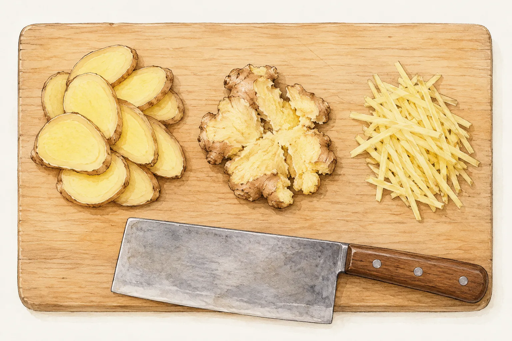
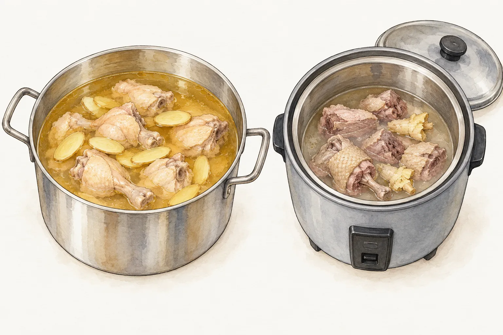
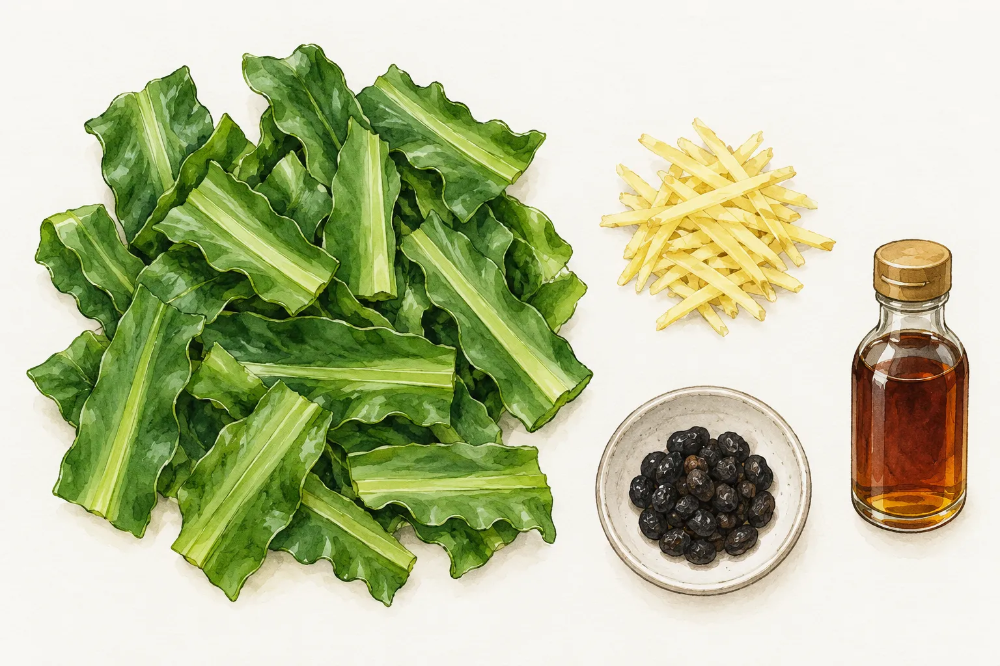

麻油和薑一起入鍋，可以接著燉雞，也可以拌麵線、炒一盤山蘇。家裡的灶腳不必為一瓶麻油準備一整桌相同味道的菜；想喝湯、吃主食，或只缺一道青菜，會選到不同的配方。買菜前先決定這餐需要哪一種，再看薑要切片、拍扁，還是切成細絲。

麻油雞常與坐月子連在一起，這層關係有詞語和地方習俗的記錄。本文從這些記錄談起，接著比較本站幾份家常菜的材料與器材，不提供產後餐單，也不把民俗中的食補說法當作料理功效。

## 麻油酒這個名字，留著生育習俗的記錄

教育部《臺灣台語常用詞辭典》把「麻油酒」解作麻油雞，提到薑、麻油、米酒和雞，也記錄它在坐月子飲食中的位置；近義詞另列「雞酒」與「麻油雞」。因此，聽到長輩說麻油酒，所指的可能是一道雞肉料理，不能只從名字理解成一杯酒。

國家文化記憶庫的〈擐酒〉，記錄的是六堆客家地區的習俗。依這份由屏東縣政府文化處建檔的資料，嬰兒出生後的十二朝，親友或鄰居會協助準備麻油雞酒，分送給親近的人；收受者再以米和生雞蛋等物回禮。記錄也提到，有些家庭的回禮已改成其他用品。這是有地域範圍的記載，各家的安排仍有變化，不宜當作全臺家庭都照辦的規矩。

文化記錄裡的菜，到了日常餐桌仍得按一份明確的配方料理。要替產婦準備餐食，不能僅憑「月子菜」這個名稱決定適不適合；此處介紹的四道菜，是一般家常選菜的比較。

## 同樣有薑與麻油，雞湯和鴨肉用的鍋不同

本站[麻油雞](/recipes/sesame-oil-chicken/)用帶骨土雞塊與老薑片，薑先和麻油以小火煸炒，再放雞肉，之後才加米酒與水燉煮。想吃這道，準備的是能留在爐上煮湯的鍋；材料裡沒有中藥包，也不需要看見「月子」兩字就自行加進藥材。

[薑母鴨](/recipes/ginger-duck/)的老薑則先拍扁，與麻油在鍋裡炒過，才和鴨肉一起移進電鍋內鍋。這份做法要用到炒鍋和電鍋兩種器材，鴨肉另有汆燙的準備。若今晚只想洗一個煮湯鍋，可以先看麻油雞；已打算使用電鍋，則要把炒薑、轉鍋和外鍋加水一起排進備料順序。

這兩份菜譜都有米酒和水，但液體用量與加熱安排不同。薑母鴨還分內鍋用水與外鍋用水，不能把所有水都倒進肉裡。照麻油雞準備好一鍋液體，再臨時換成電鍋煮鴨，也會漏掉原配方的條件。選菜時先選主角與鍋具，實際用量回到那份材料表核對。

西港區農會的麻油雞做法也使用雞、老薑、黑麻油、米酒和水，卻另有雞肉先汆燙的安排。它與本站版本可以用來看出同名菜的差異，不必把兩份步驟拼在一起。本文只比較材料形態和流程，不用肉色、湯色或插畫判斷雞鴨是否熟透，也不據烹煮時間保證酒精已經消失。

## 想吃主食，麵線另煮再拌

若想把麻油用在主食，可以選本站[古早味麻油麵線](/recipes/sesame-oil-vermicelli/)。這份配方除了白麵線、老薑和黑麻油，還有米酒及高湯。採買時要把高湯一起算進去，家裡只剩麻油和一把麵線，還沒有備齊這份菜的材料。

它把煮麵和調麻油薑汁分開處理：一邊以老薑片做醬汁，另一鍋把麵線煮熟，瀝去煮麵水後再拌。和前一節連肉帶湯燉成一鍋的料理相比，這裡要預留煮麵鍋與拌麵的空間。湯鍋裡加麵線是另一種安排，不能直接當作這份拌麵配方的最後一步。

麵線這餐若已搭配麻油雞，再加一份麻油薑汁，是兩份不同的調味一起上桌。可以先決定要吃獨立的拌麵，還是按所選菜譜安排其他主食，不必每樣都做。本站這份使用雞高湯或大骨湯，選給不吃肉的人時也要看材料，不能只看成品沒有肉塊就當成素麵。

## 缺一道青菜，山蘇配的是薑絲與豆豉

本站[麻油炒山蘇](/recipes/sesame-oil-birdsnest-fern/)用生薑絲，不沿用麻油雞的老薑片，也不把薑母鴨拍扁的薑塊搬過來。備料時山蘇切段，薑另切絲，豆豉也要先取好；這幾樣會一起出現在炒鍋裡。西港區農會刊載的「麻香山蘇」同樣有這組材料，是與雞湯不同的麻油用法。

做法先以小火處理黑麻油和薑絲，加入山蘇、豆豉後才轉到大火快炒，最後再加米酒等調味。這個火力變化屬於山蘇這份配方，不能反推所有麻油菜都要一路小火，也不代表雞湯可以照同樣節奏完成。青菜起鍋的安排，和肉類長時間留在鍋中燉煮，要分開看待。

想做山蘇時，先確認家中有豆豉；若冰箱只有雞肉與老薑，則回頭選雞湯，不必硬湊出同一道菜。這盤山蘇也有米酒，不能因為它是青菜，就替需要避開酒類的人省略詢問。選定菜色後，再打開對應菜譜核對完整材料與用量。
