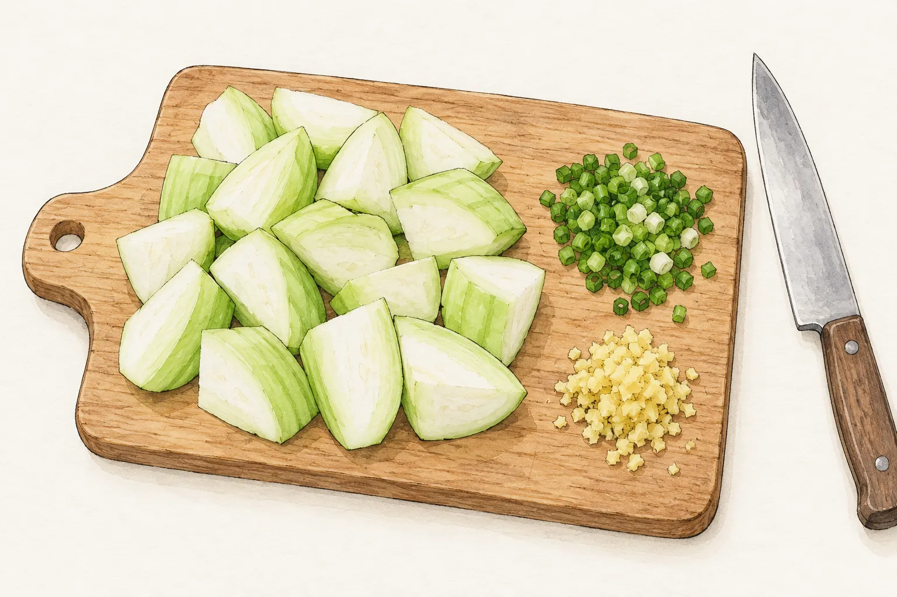
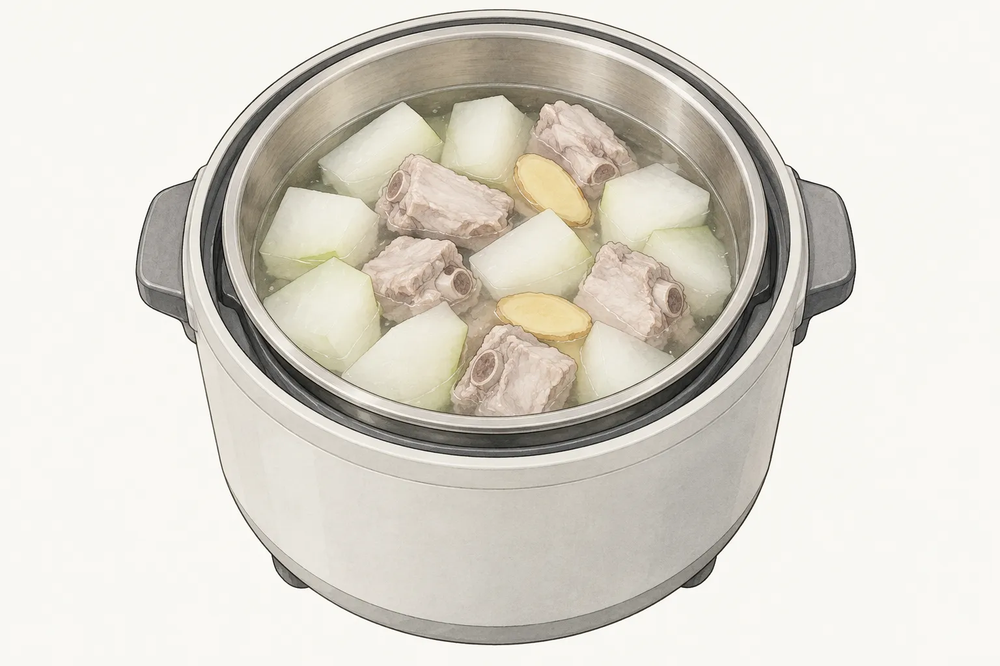
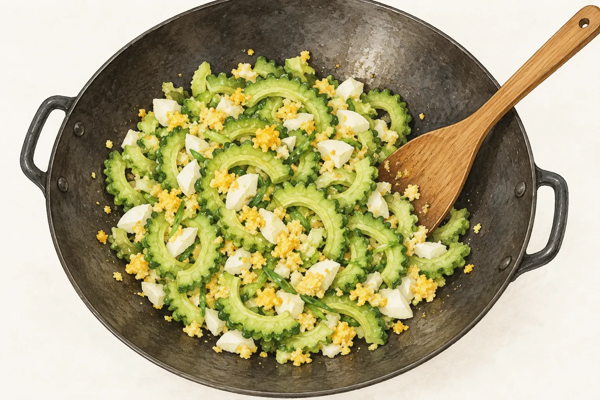

絲瓜切塊配蛤蜊、冬瓜切塊入排骨湯，苦瓜則切成薄片拌熟鹹蛋。三道菜都用瓜，從備料到起鍋卻走不同的路：有的在炒鍋裡先炒再煮，有的把材料放進電鍋，有的先汆燙再短時間拌炒。買菜時先選定一道，回家才知道該拿出湯鍋、炒鍋，還是電鍋內鍋。

想安排配飯的菜，可以先看絲瓜蛤蜊的薄芡與鹹蛋苦瓜的拌炒；需要一鍋湯，再看冬瓜與排骨如何一起入電鍋。以下從切法、用水與收尾來讀三份配方，也比較外部食譜的不同版本，完整用量則回到選定的菜譜。

## 絲瓜先切塊，留意蛤蜊與湯汁的收尾

農業部的六月食譜，把絲瓜、苦瓜和冬瓜列在芒種、夏至可吃的當季食材中。這是夏季選菜的背景，沒有把現在的十月說成三種瓜共同的盛產期。平日逛市場買到其中一種，仍可先依想吃的料理選做法。

本站[絲瓜蛤蜊](/recipes/luffa-clams/)把絲瓜削皮、去籽後切成小塊，青蔥與薑也先切好。蛤蜊經前段處理後，才進入同煮的階段。這份配方先用小火炒蔥粒和薑末，絲瓜接著下鍋，略炒後才加入蛤蜊與調味用的水。準備工作做到這裡，應該看得到分開的絲瓜塊、蔥粒和薑末，旁邊備好稍後會用到的調味。

龜甲萬刊載、李德全設計的絲瓜蛤蜊湯麵，也先處理蛤蜊，再炒絲瓜，之後加湯水同煮。那份是湯麵，最後要把湯料澆在麵上；本站這道則在末段加太白粉水，讓鍋底湯汁略帶濃度。要吃一盤配飯的絲瓜，或一碗有麵的湯，應在備料前就選好版本，水量與調味不能從兩邊各取一半。

本站材料表另列太白粉水和香油，這兩項都留在最後使用。前段切瓜時可一併確認調味是否備齊，讀到收尾就不必再回頭找材料。圖裡只畫備料的一部分，沒有把沒畫出的調味省略；插畫用來辨認切法，完整採買仍看菜譜。

看本站步驟時，可以把「同煮」和「勾薄芡」分成前後兩段。先照菜譜完成絲瓜與蛤蜊的烹煮，再處理湯汁濃度；薄芡是這道菜的收尾安排，不能拿湯汁變稠當成前面已經煮好的依據。這份配方材料表列有五十毫升水，加入的位置在絲瓜略炒之後；備料時把它和最後使用的粉水分開準備。

## 冬瓜排骨一起入電鍋，內外鍋的水分開看

冬瓜排骨湯的安排，是先把冬瓜和排骨各自處理好，再放進同一個內鍋。冬瓜削皮、去籽後切塊；排骨則先汆燙、撈起洗淨。把這兩項備料做完，才加入薑片、米酒和湯水，開始電鍋蒸煮。冬瓜沒有先在炒鍋裡炒，也沒有照絲瓜蛤蜊的方式最後加粉水。

保誠刊載的冬瓜排骨湯，與本站使用相同的主要材料份量：冬瓜一千五百公克、排骨六百公克，內鍋用水二千五百毫升。這是一鍋六人份的安排，不能看到前一節絲瓜蛤蜊是兩人份，就把兩道菜的瓜量或用水直接相比。買回一小塊冬瓜時，也先確認要做幾份，再回菜譜看完整用量。

這道菜還有兩個不同位置的水。材料表裡的二千五百毫升，是和食材放在一起的湯水；外鍋另外加兩杯水，用於這一輪蒸煮。閱讀時把位置認清楚，才不會把外鍋兩杯誤當整鍋湯的水量，或把內鍋的水全倒到外面。插畫呈現的是材料已裝入內鍋、準備開始煮的狀態，沒有用瓜肉外觀替代完成判斷。

電鍋開關跳起後，這份做法還有加鹽、蓋回去燜約五分鐘的收尾。開關跳起是這份配方的一個階段，後面仍留有加鹽與燜煮的時間。想照這個同鍋安排煮湯，可以前往[冬瓜排骨湯](/recipes/winter-melon-pork-rib-soup/)核對四個步驟；換成爐火燉湯時，另找對應的完整配方。

## 苦瓜先切薄片，熟鹹蛋整顆切碎再拌炒

苦瓜這道改走薄片與短時間拌炒。本站[鹹蛋苦瓜](/recipes/salted-egg-bitter-melon/)先去籽、處理內側白膜後切片，汆燙、沖涼並瀝乾，接著才和熟鹹蛋一起炒。備料時需要的是薄片，不能把前兩道的瓜塊切法照搬過來，卻仍沿用這份快炒步驟。

本站這份是兩人份，材料表用一條苦瓜與一顆熟鹹蛋；外部版本則以苦瓜片的重量列量。兩邊的計量方式不同，本文不替一條瓜補上未提供的公克數，也不把較大的瓜直接當成相同份量。

熟鹹蛋在這裡整顆切碎，蛋白與蛋黃都會進鍋。先把青蔥、大蒜等材料備妥，再照菜譜的次序炒香，加入苦瓜、鹹蛋及調味拌炒。圖中同時看得到淺色蛋白碎和黃色蛋黃，對應整顆切碎的備料方式。

龜甲萬刊載、吳庭宇設計的另一份鹹蛋苦瓜，材料直接列燙熟的苦瓜片，先炒蔥段，再把壓碎的鹹蛋、苦瓜和調味略炒。兩份都有「苦瓜先處理、鹹蛋切碎、後段拌炒」的安排，但使用的調味並不一樣。本站有蒜末與香油，那份另用醬油和鮮美露；選定本站版本，就不另外把那些醬料加進來。

外部這份做法沒有交代汆燙秒數，也沒有提供減苦的化學解釋。本文因此只比較操作，不承諾汆燙或挖白膜能把苦味完全去掉。今晚想吃有湯的一鍋，可以選冬瓜排骨；想留薄芡配飯，查看絲瓜蛤蜊；想做苦瓜薄片拌熟鹹蛋，就把汆燙與炒鍋這兩段先安排好，按選定菜譜備料。
