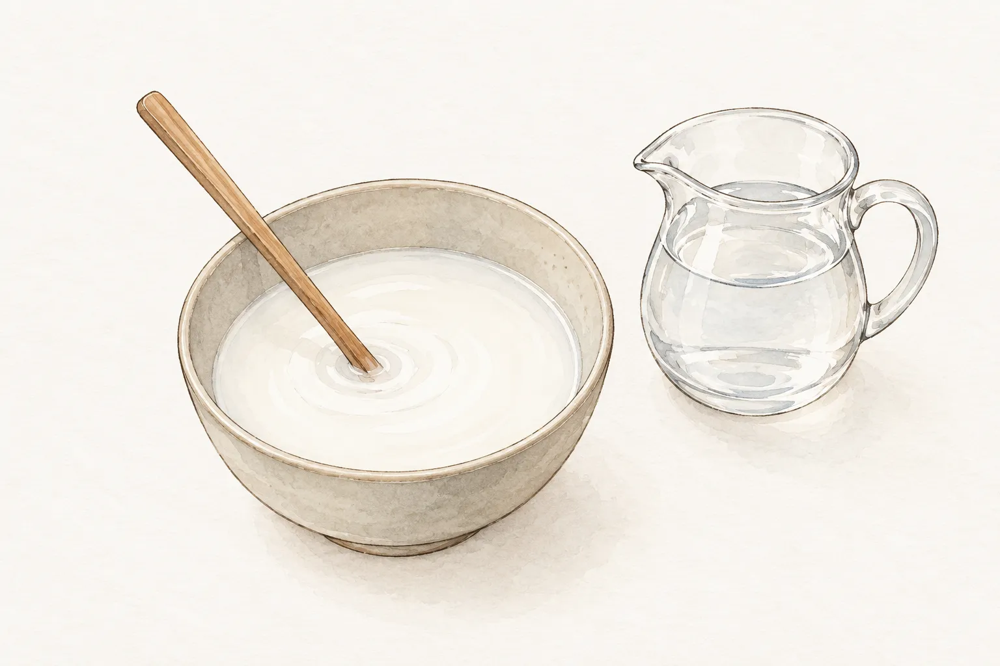
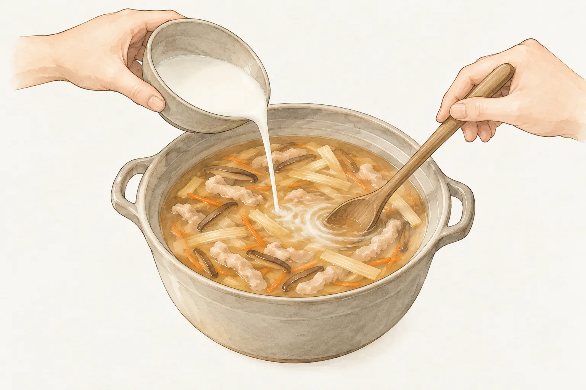
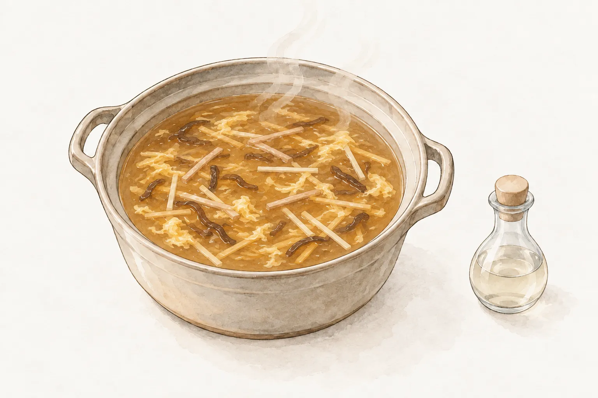

湯底和配料都煮好了，最後倒入粉水，卻出現幾顆白色粉團；多補一點，又把原本想喝的羹湯煮得太厚。勾芡這一步看似短，實際上要處理兩件事：讓澱粉均勻分散，並在加熱後看清濃度再決定要不要繼續加。

在家煮肉羹湯或酸辣湯，可以先把調粉水的小碗留在鍋邊。粉水準備好了，不代表一定要整碗倒完；鍋裡的湯量、配方指定的澱粉與想要的濃度，都還要一起對照。

## 包裝上的成分，比粉的白色外觀更有用

買粉時先看成分標示。衛生福利部的食品標示說明以太白粉為例，要求內容物寫明實際使用的原料，例如樹薯粉或馬鈴薯粉。只記住袋子正面的品名，未必已經確認原料。

玉米澱粉、馬鈴薯澱粉與樹薯澱粉，不能因為看起來都是白粉，就直接當成同一份材料。杜克大學的烹飪教材提醒，不同來源的澱粉增稠能力有差異。因此，食譜寫的是哪一種粉，採買時就先找對應的產品；手上只有另一種時，另找明寫那種澱粉的做法，比自行套用固定替換比例清楚。

[肉羹湯](/recipes/pork-thick-soup/)使用太白粉水。若採用的配方沒有明確比例，先找用量完整的版本再開始，別借用另一道湯的數字。

## 用冷水調勻，倒進鍋前再攪一次

粉水先在小碗裡調開，再接觸熱湯。Argo 的玉米澱粉使用說明要求先與冷液體混合，以免直接加入熱液體時結塊；杜克大學教材也把冷液調粉列為勾芡的準備步驟。這裡的冷水是用來分散粉，調好的白色液體還不是完成的芡汁。

料理作者 Nami 在 Just One Cookbook 的粉水說明中提醒，澱粉放置後會沉到碗底，加入料理前要重新攪勻。於是，備料時已經拌過一遍，到了鍋邊仍有一個動作要做：把碗底沉下來的粉重新帶起，讓粉水恢復均勻。

可觀察的地方很具體。小碗裡不應還有乾粉堆，倒之前也要確認底部沒有留下厚厚一層粉。若上面倒出的是清水，底下卻剩著粉，前後加入鍋裡的內容就不一致。先把這一步完成，再處理熱湯，比粉已下鍋才追著粉團攪更容易掌握。小碗裡的乳白色，是調粉水時的觀察；湯鍋裡是否已經變稠，則要等下鍋加熱後再看。這兩個階段分開，才不會把「粉已拌開」當成「芡已完成」。

## 少量加入，攪拌後看湯怎麼流

粉水入鍋時，讓湯保持食譜要求的加熱狀態，邊加邊攪拌。杜克大學教材示範把粉水慢慢倒入微滾液體，持續攪動倒入的位置，並以少量加入的方式掌握濃度。

澱粉需要加熱才會讓液體增稠，粉水剛接觸湯面時，還不適合立刻認定「不夠濃」。依選定的配方攪勻、加熱，觀察這次加入後的變化，再決定下一次要不要補。Nami 的做法同樣採分次加入並檢查濃度，沒有要求把準備好的粉水一次用盡。

站內[酸辣湯](/recipes/hot-and-sour-soup/)的目標是薄芡。閱讀這份菜譜時，可以把「湯仍能流動、只是略帶濃度」當成要觀察的質地，而不是追求越厚越好。鍋裡還有豆腐、木耳與筍絲；看湯汁的流動，比單看滿鍋配料堆得多高，更貼近勾芡這一步想調整的部分。

## 太厚先調整液體，太稀另調粉水

如果湯已經比預期濃，先停止加粉水。Nami 的粉水說明提出以少量水調稀；若仍太稀，則另外調好粉水再加。補粉依然要回到小碗裡先調勻，不能因為急著補救，就把乾粉直接撒進熱湯。

每次只調整一點，攪勻後重新觀察，才知道剛才的變動帶來什麼結果。加水也改變了原來湯汁與調味的比例，後續仍要依菜譜完成調味；這不等於可以跳過配料原本需要的烹煮步驟。

若整鍋還沒到要勾芡的階段，粉水可以先放著，等準備使用時再攪。若已經達到希望的濃度，小碗有剩也不必為了用完而繼續倒。留下這個停手的餘地，是分次加入最直接的用途。

## 勾好芡之後，照這道湯的順序收尾

酸辣湯接下來還有蛋花與酸味。本站採用的兩份原作者食譜都安排先勾芡，再在後段加入醋；站內版本也把蛋液與最後調味分開。這個順序可以照著讀，卻不需要延伸成「所有羹湯都必須最後放醋」的通則。

讀兩份酸辣湯原作時，還能看到湯量的差別：愛料理官方品牌廚房用八百毫升高湯，小磨坊版本用一千毫升水。即使菜名相同，材料表也有自己的安排。採用其中一份，就連同湯量、粉種與調味順序一起看；只抽出粉水比例，並不能交代另一鍋湯需要多少芡。

準備下鍋時，先在冷水裡把粉調勻；等湯料煮到配方指定的階段，再攪起碗底沉粉，分次加入。每次攪勻後，等這一批受熱、看清湯汁的變化再決定是否補。想要的濃度到了，就停下加粉水，接著把這道湯的蛋花與調味完成。
