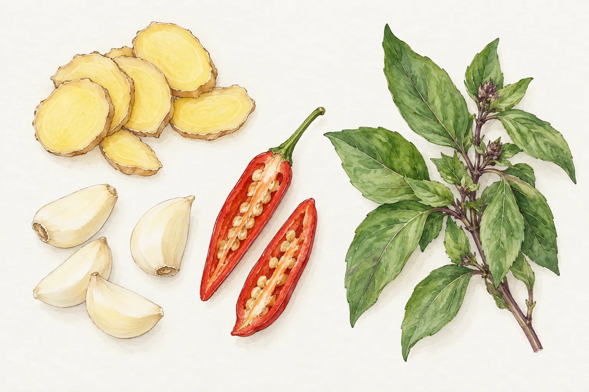
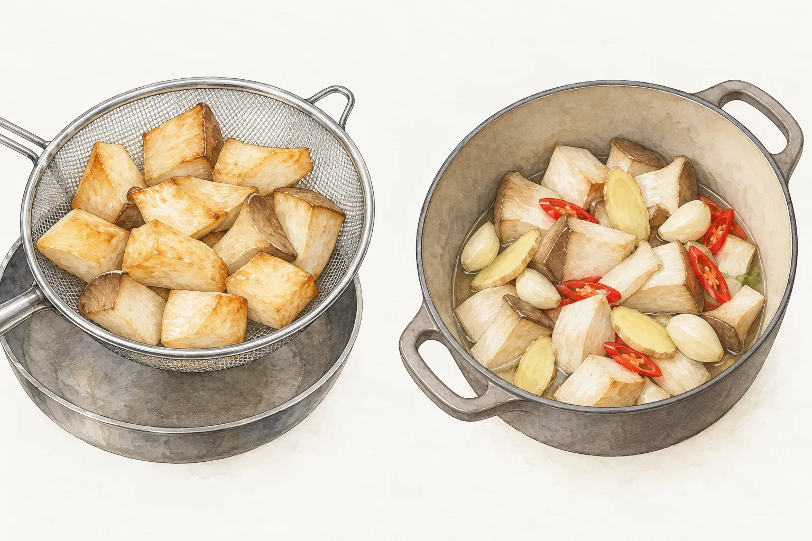
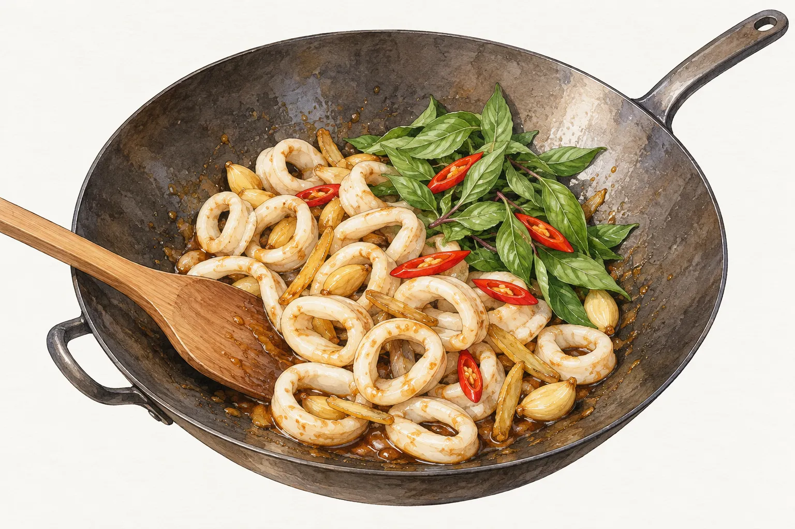

三杯雞、三杯杏鮑菇與三杯透抽，都能看見薑、九層塔、麻油與米酒，醬料和烹調順序卻各有安排。雞肉可以移進砂鍋慢慢收汁，杏鮑菇有先炸和直接燜炒的做法，透抽也有先汆燙、再進醬汁的版本。換了主料，連同它下鍋前要做什麼，一起看會更清楚。

這裡比較龜甲萬李德全老師、食譜自由配洪媽媽、Flambo 富蘭鍋與厚生市集的示範。文中的操作各自屬於具名的配方；段落連結另通往本站整理的版本，材料用量與做法可能不同。

## 薑片先下鍋，辛香料各有順序

三杯的備料桌上常有薑、蒜與辣椒，但四份示範沒有把它們全都排在同一個時間下鍋。李德全的三杯雞以胡麻油炒薑片和辣椒；洪媽媽的杏鮑菇則先爆香薑片，再加入麻油及醬料。這兩份配方都沒有列蒜頭。

Flambo 的做法先用小火炒薑片，等邊緣稍微捲起，才接著炒蒜頭與辣椒。厚生市集則把薑片和蒜仁一起放入麻油，以蒜仁變成金黃色作為下一步的訊號。讀到「爆香」時，可以再往下找是哪一種材料的外觀改變，依正在做的版本觀察。

九層塔在這四份示範裡都留到後段。李德全在備料時挑掉粗莖，厚生市集也先去梗；葉片處理好後，和前面要炒的薑蒜分開，照著下料順序拿取。辣椒也另外看，厚生市集的透抽把它留到最後，與九層塔一起入鍋。

## 雞腿肉炒過，再進砂鍋收汁

李德全在龜甲萬的三杯雞示範使用雞腿肉。辛香料炒過之後，雞肉先在炒鍋裡翻炒，接著加入醬油、砂糖與米酒。醬汁煮滾後，整份材料移入砂鍋，用小火繼續煮，九層塔等到湯汁收乾才拌入。

這份做法需要炒鍋和砂鍋，開火前把兩口鍋都備好，也先留意換鍋後要用小火。前段有翻炒，後段是讓材料在砂鍋裡續煮，讀步驟時把這兩段分開看。九層塔另放在旁邊，等收汁完成才拿取。本站的[三杯雞菜譜](/recipes/three-cup-chicken/)另整理了一套家常做法，可對照手邊材料選擇。

## 杏鮑菇可以先炸，也可以直接燜炒

杏鮑菇切塊之後，有兩種不同的起手式。洪媽媽在食譜自由配的示範先把菇塊下油鍋，炸到表面微黃便撈出。鍋裡的炸油倒出，接著處理薑與醬料，再讓杏鮑菇回鍋拌勻。準備這個版本，會多出炸菇、撈起與倒出炸油的工序。

Flambo 使用鑄鐵鍋，杏鮑菇接在薑、蒜、辣椒之後入鍋，炒到出水才加入後續調味，然後以小火燜煮。它觀察的是菇塊炒過後出水的狀態，洪媽媽觀察的則是油炸表面微黃，兩份示範的下一步各接著不同的操作。

手邊有杏鮑菇，可以先選擇要不要安排油炸，再決定看哪一份完整配方。直接燜炒也有炒菇、加料與收汁的順序，需要留在鍋邊觀察。洪媽媽在菇塊拌醬後加入九層塔與辣椒，熄火再用餘溫翻拌；Flambo 則在起鍋前加入九層塔，繼續拌炒收汁。本站的[三杯杏鮑菇菜譜](/recipes/three-cup-king-oyster-mushrooms/)也可一併參考。

## 透抽先汆燙，醬料先在鍋裡煮

厚生市集的三杯透抽把主料與醬料分段處理。透抽切圈後先汆燙，暫時撈出；另一邊以麻油炒薑蒜，再把醬料放進鍋裡煮。透抽回鍋時，前面的辛香料與醬料已經處理過，最後才加入九層塔和辣椒拌炒。

這份示範把醬料小火煮約兩分鐘，再讓汆燙過的透抽以大火炒約一分鐘。兩段時間對應的是不同內容，讀配方時要連著前面的汆燙一起看，不能省掉前段，再把後段時間當作生透抽的全部烹調時間。

厚生市集最後把九層塔和辣椒炒軟，就完成這一段操作；九層塔沒有跟著前面的醬料一起煮。想做透抽，也可看本站的[三杯透抽菜譜](/recipes/three-cup-squid/)，依該頁安排準備。

## 醬油、醬油膏與素蠔油分開看

幾份配方的醬料也有差異。李德全的雞肉使用醬油和砂糖；Flambo 的杏鮑菇使用醬油膏，另列砂糖與鹽；洪媽媽的杏鮑菇把素蠔油和醬油搭在一起。厚生市集的透抽同時使用醬油、醬油膏，還列了糖與烏醋。

用量也跟著主料份量讀。李德全以四百公克雞腿肉，搭配醬油四十毫升、胡麻油和米酒各兩大匙。Flambo 的五條杏鮑菇配方，黑麻油是一點五大匙、米酒三大匙，醬油膏則列二至三大匙。同一份菇類配方裡，油、酒和醬料的量就有差別。把它寫進備料清單時，連同五條杏鮑菇這個前提一起保留；其他食材換進來，要另找相應配方的份量。

採買時照材料表核對瓶身品名，洪媽媽列的是素蠔油，厚生市集的醬油和醬油膏則各有一筆。量取時也把大匙和茶匙分清楚，準備好的醬料放在一起，辛香料另外排放，就能對照步驟確認哪些先進鍋、哪些留到收尾。

要從家裡現有的材料挑一道，可以先看主料，再看願意使用的鍋具與工序：有砂鍋可讀李德全的雞肉示範；想用鑄鐵鍋做菇類可看 Flambo；願意多一道油炸可看洪媽媽；透抽則先確認要做的配方是否安排汆燙。決定版本後，把它的材料表與步驟放在一起讀。
