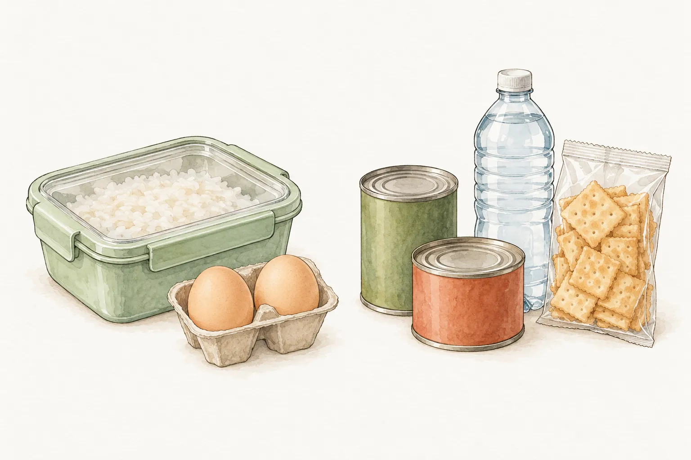
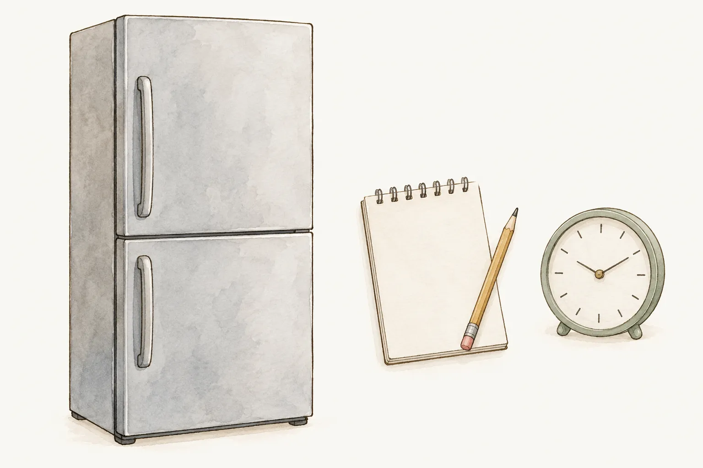
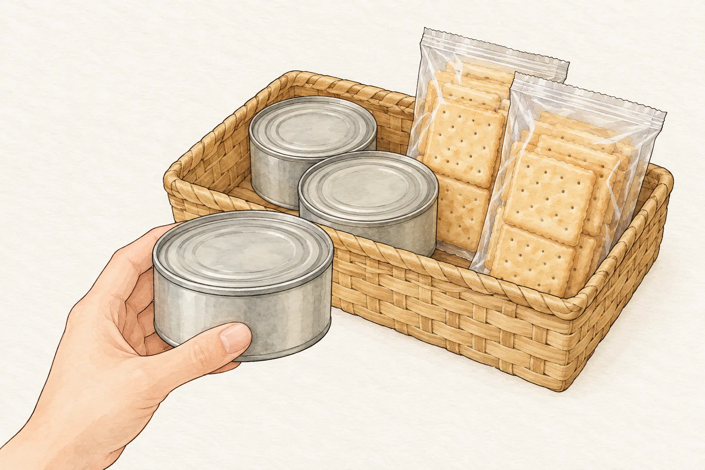

颱風前採買，冰箱裡可能多了肉、蛋與青菜，櫥櫃也補進白米和罐頭。這些食物要分成兩種安排：水電與保存條件正常時，照平常的方式煮飯；無法冷藏或烹煮時，另有不必依賴冰箱的備用餐。只把冰箱塞滿，第二種安排仍可能空著。

這篇不替每樣食材訂一個「可以撐幾天」的期限，也不把停電後趕快煮掉當成補救。採買時先確認保存要求，停電時留下時間紀錄，復電後才有依據判斷哪些應丟棄。家常菜與備糧可以一起規畫，食安條件則要各自核對。

## 今天能煮的菜，另列一張清單

[高麗菜飯](/recipes/cabbage-rice/)把白米、高麗菜、肉絲與泡過的香菇、蝦米一起安排，最後用電子鍋完成。家裡水電正常、材料保存妥當時，可以照完整菜譜備料；採買清單卻不能只寫「米和乾貨」，漏掉肉絲的保存與煮飯所需的水、電。

[蛋炒飯](/recipes/egg-fried-rice/)用的是熟白飯，還要準備雞蛋和青蔥。若想用剩飯，先核對前一餐到現在的保存經過。本站[剩飯專題](/topics/leftover-rice/)整理了這部分；本篇不把冷飯容易炒散的料理選擇，當成失溫飯菜仍能食用的證據。

食安辦的防災飲食建議提到，優先安排冰箱裡易壞的食物。這個順序只適用於仍能安全使用的材料。衛福部也要求生肉、海鮮與其他食品分開處理，熟食及易腐食品不要放在室溫超過兩小時。預先煮好一大鍋，卻沒有適當的保存條件，並沒有解決下一餐的問題。

## 備用餐要能在當下吃得到

臺灣全民安全指引把儲備食品分為不用煮與可以簡單烹煮兩類。買米、乾麵條或調理包時，要連同需要的水、加熱方式一起想；罐頭、米餅等則可依產品標示挑選不必再煮的品項。外觀同樣是包裝食品，保存與食用要求仍可能不同，採買時看清楚標示再歸類。

現行指引建議以家庭為單位準備至少七天份物資，飲用水則是每人每天至少三公升。七天是居家儲備的準備量，沒有替開封食品或冰箱裡的菜延長保存期限；三公升在這份指引中指飲用水，也不能直接當成全家的洗滌與料理總用水量。

備糧可以選平常就會吃的口味，與日常物資分開管理，分散存放，讓家人知道各處放在哪裡。要加熱的留在「條件允許才煮」的安排裡，另備可直接食用的選擇。遇到無法安全取水、備料或煮食的情況，就不必為了用掉冰箱材料，勉強照原訂菜單開伙。

## 停電時關好冰箱，記下開始時間

停電後少開冰箱，是衛福部提醒的做法。門一再打開，會讓內部溫度升高；想起一樣食材就開門查看，反而不利保冷。可以先記下停電開始的時間，再確認接下來能使用的常溫備糧。圖中的時鐘只是提醒記錄時間，沒有表示某個時刻之前一定安全。

美國官方 FoodSafety.gov 的停電指引，以冰箱門維持關閉為前提，估計冷藏室約能保冷四小時，CDC 也建議，在停電且沒有另加冰塊等冷源的情況下，四小時後丟棄肉、魚、蛋及剩菜等易腐冷藏食品。這是停電處置指引，不能把四小時當成所有冰箱、所有食物的保證。

同一份表格另用食物處於華氏四十度（約攝氏四度）以上超過兩小時，判斷許多易腐食品應丟棄。這裡算的是食物失去低溫的時間，與「從幾點開始停電」不同。若不知道先前保存狀況、溫度或持續時間，不要自行從復電那一刻重新起算，也不要靠試吃判斷。

## 復電後逐樣看，冷藏與冷凍分開判斷

同在冰箱裡的完整蔬果、切好的蔬果與煮熟的飯菜，處置並不相同。FoodSafety.gov 的冷藏表將完整未切蔬果與已切、已煮熟的品項分列。不能因為一顆完整高麗菜的條件與肉類不同，就認定拌進肉絲、煮成的高麗菜飯也能照同樣方式留下。

冷凍食品也有自己的判斷。該表對仍留有冰晶，或溫度在華氏四十度（約攝氏四度）以下的冷凍肉類，列有重新冷凍的處置；這不代表品質不變，也不能推到所有冷凍品，例如冰淇淋就另列丟棄。已解凍的肉若在上述溫度以上超過兩小時，表中要求丟棄。看不清保存經過時，採取有疑慮就捨棄的做法。

泡過水、疑受污染的食品，則不能只靠冰箱溫度判斷。衛福部要求丟棄可能受病原污染的泡水食物；嘉義縣衛生局也提醒，生鏽、裂損或變形的罐頭不要食用。這些情況都不適合再放回當天的菜單。復電只代表供電恢復，沒有證明裡面的食物仍可吃。

## 平日吃掉近效期的，再補回備糧

儲備食物放在陰涼乾燥處，依標示保存，並定期查看包裝與效期。食安辦建議先使用接近到期的食品，再補進新的；全民安全指引也提醒每半年檢查物資。把檢查排進平日採買，比等到發布颱風消息才逐包翻找容易執行。

收納時可把需要先用的放在容易拿到的位置，讓食用與補貨接得上。插畫省略了包裝文字，實際管理仍須保留產品標示，核對效期與開封後要求。吃掉一份就記下一份，下一次採買照清單補回，不把「還有一整籃」當成數量與狀態都已確認。
