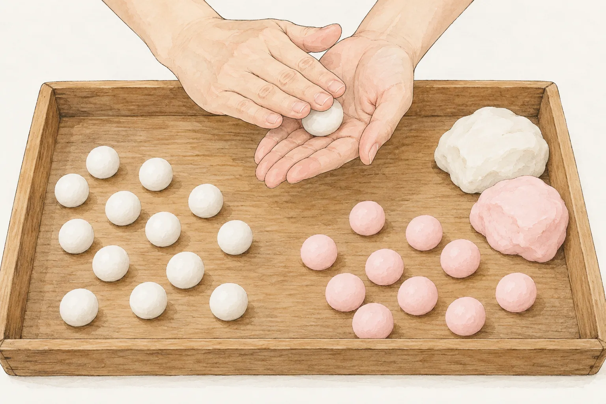
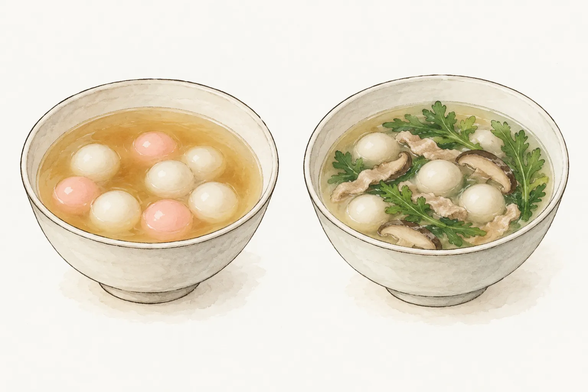
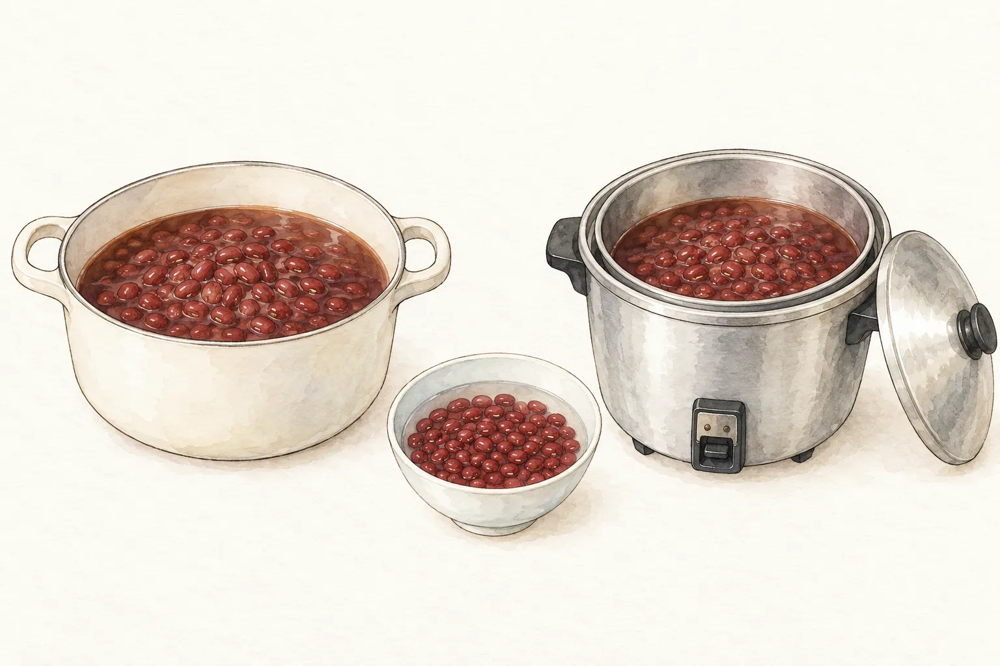

冬至的湯圓，可以是一碗清甜的小圓，也可以和青菜、肉絲一起煮成鹹湯。若還想添一鍋紅豆湯，採買與備料便多了一條線：湯圓要選哪種，紅豆又打算用哪個鍋煮。先把這兩件事分開想，才不會買回一袋小圓，臨時把幾份配方的時間和用水拼在一起。

這篇從冬節圓的文化記錄談起，再回到家裡的選菜與器材安排。節氣的位置可對照本站[二十四節氣頁](/solar-terms/)。這些文化記錄提供選菜的背景；實際比例與烹煮方式，仍回到選定的完整配方。

## 冬節圓，從一家人搓圓的晚上談起

農業部的冬至介紹，記錄過去在節日前夕磨糯米、到了晚上全家一起搓湯圓的情景，並把湯圓連到團圓過冬的寓意。準備食物也成了家人聚在一起的一段時間。今天也能在市場買到現成湯圓。想把時間留給一家人吃飯，可以選購現成的；喜歡一起動手，則另找完整的搓圓做法，把備料排在聚餐之前。

國史館臺灣文獻館的「冬節圓」條目，還記錄孩子把粿粉捏成雞、鴨、狗、貓等形狀，稱作「雞母狗仔」，蒸熟後作為祭祖供品。這段記錄讓人看見，同樣的米食材料，當時也用在圓球以外的造形。各家的祭拜與飲食安排仍有差異。

「吃了冬至圓又添一歲」是節日裡的說法。介紹給孩子時，可以連同家人一起搓圓的背景說明；若家中本來就有不同的做法，也可以從家人自己的記憶談起，不用拿一則地方或歷史記錄校正所有人的過節方式。

## 紅白小圓先看材料，甜鹹再看湯

農業部稻米主題館介紹的做法，是把圓糯米磨成漿，經脫水成團，再揉成小球；其中一部分添入食用色素，便有紅白兩色。這是材料與形態的介紹，沒有提供可以直接照做的粉水比例。想從粉團開始製作，仍要另外選定完整配方，不能看著插畫估水量。

紅白配色也出現在鹹湯圓。新北市的客家文化典藏有冬節廣播文字，記錄紅白鹹湯圓與「金銀」的稱呼。這份記錄裡，紅白小圓同樣可以走進鹹湯，顏色並沒有把口味分成兩邊。

採買前可以先問家人想吃糖水小圓，還是有青菜與肉的鹹湯，再核對所選產品或配方。本文談的是這些記錄中的小圓，不把它直接套到包餡的大湯圓；大小、是否有餡與保存狀態不同，烹煮指示也要跟著那份產品或完整菜譜走。

## 糖水和鹹湯，配料要分開準備

稻米主題館列出的甜湯例子是在湯中加糖；鹹湯例子則加入茼蒿、香菇與肉絲。兩碗都能放小圓，採買清單卻差了一截。想煮鹹的，要把肉與青菜算進這餐，不能只備好糖和湯圓，到了爐前才決定換口味。

若是聚餐後的一碗甜湯，可以先在糖水小圓與紅豆湯之間選擇；若家人想吃含菜、肉的鹹湯，則另找材料與步驟完整的版本。確定口味後再找完整做法，備料才有份量依據。這裡只列組合，不提供鹹湯的用量與步驟。

實際料理時，沿用所選配方或包裝的操作方式。若要做素的，配料和湯底都得一併核對；本節所舉的肉絲鹹湯不能直接當素食選項。

## 紅豆湯要留備料時間，也要先選鍋

農業部食農平台在二〇二五年冬至前介紹過紅豆湯，列出的作期是九月中旬至十月上旬播種，十二月下旬至隔年一月上旬採收。這份作期資料把紅豆與冬日餐桌連在一起。採買時可以看看包裝的產地與產品資訊，認識這鍋甜湯裡的豆子從哪裡來。

本站[紅豆湯](/recipes/red-bean-soup/)是爐上煮的版本，材料為紅豆、水與細砂糖，從浸泡開始安排，再以鍋子煮到豆皮略裂，之後調甜味並燜。採買清單雖然短，仍要預留泡豆與煮豆的時間。想照這份做，先打開材料表與步驟，再決定何時開始備料。

農業部食農平台刊載的則是電鍋版本，包含內鍋的紅豆與水、外鍋加水，以及跳起後的燜放與後續蒸煮。兩份做法可以用來比較器材，不能把本站的泡豆時間接到另一份的外鍋水量，拼成第三份沒有查核的配方。尤其內鍋和外鍋的水各有位置，不能合計後全部倒進紅豆裡。

若這次只打算做一鍋甜湯，本站紅豆湯已經是一份完整的選擇。若還要搭湯圓，把紅豆湯與湯圓各自需要的備料、鍋具及烹煮指示列出來，再安排完成順序；兩者先各自選定做法，不在這裡改成同鍋配方。選好爐煮或電鍋版後，就維持那份做法的條件，不在中途只換鍋，卻留下原來的時間和水量。
