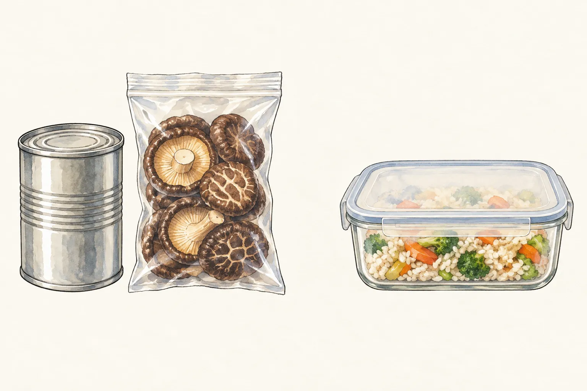
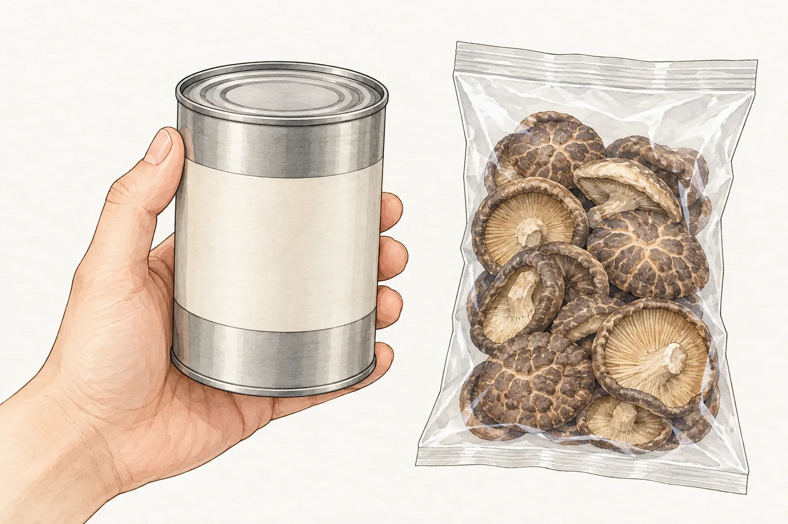
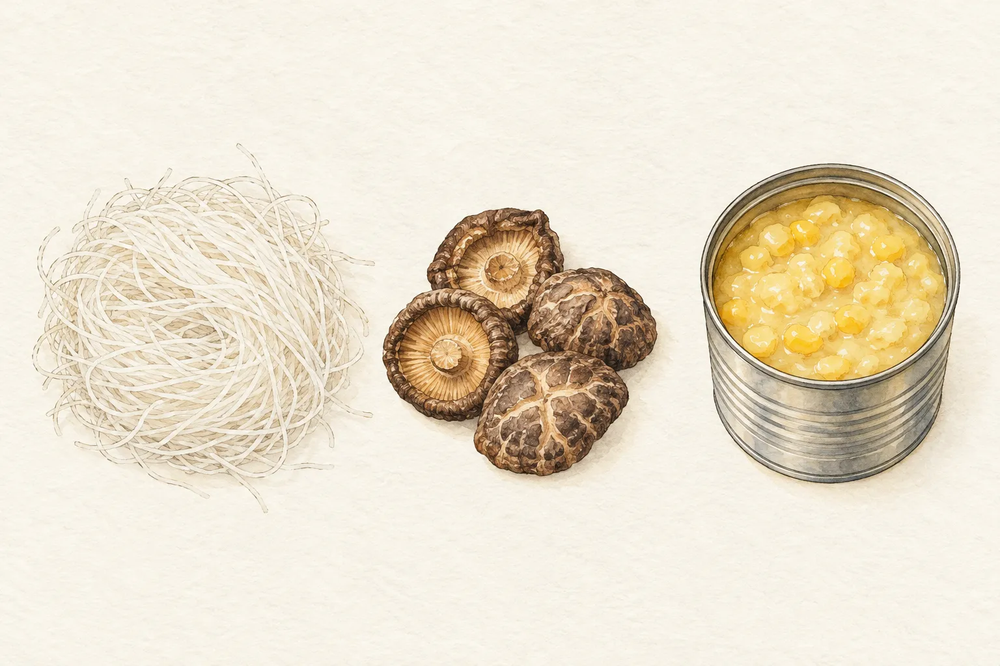

準備普渡供品時，採買清單常先寫要買什麼，較少接著寫誰會吃、哪一餐用。等供品收回，才發現乾貨重複買了幾袋，熟食也超過當天能處理的份量。把拜後的去處提前安排，挑選時就有了更具體的依據。

這篇從家庭餐桌出發，不替地方或家族訂祭拜規矩。要準備哪些供品、如何配合社區活動，仍須依參與場合確認；料理部分則看食品本身的保存條件，不能因為同放在一張供桌，就用同一種方式收拾。

## 供桌有不同樣貌，先問清楚參與的場合

國史館臺灣文獻館的民俗辭典記錄，農曆七月的普渡包含不同時間與對象的祭拜，供桌也有較繁複和簡化的安排。另一則「中元普渡物品」辭條提到，廟宇可能在中元節當天，或在七月另擇固定日子舉行法會。這些記錄呈現的是不同做法，不能抽出其中一項，就要求每一家照辦。

同一則辭條列出的祭品，從白米、粽子、刈包，到泡麵、餅乾、飲料與水果都有。它們在祭祀場合同屬供品，回到廚房卻有完全不同的需求。熟食需要留意時間與溫度，未開封包裝食品要看標示，乾貨還得接上家裡實際會煮的菜。

若是參加社區共同普渡，採買前先確認需要自備的品項，以及食品何時能領回。若家人已有慣例，先把那些品項列出，再討論份量。本文提到的乾米粉、香菇與玉米醬，是接回家常菜的採買例子，沒有把它們當成普渡必備的固定組合。

## 採買清單多寫一欄：拜完怎麼用

彰化縣衛生局的祭祀食品選購提醒，採買數量要考量家中人口與冰箱容量。實際列清單時，可以在每個品項旁補上「預計哪一餐用、還缺哪些材料」。只有一袋米粉，並不等於炒米粉的晚餐已經備齊；若家裡很少煮湯，再多的玉米醬也可能一直留在櫥櫃裡。

先數家裡已有的存貨，再決定是否補買。同樣是香菇，若櫥櫃還有未用完的一包，就把它排進菜單，不必為了整齊的供品組合再買相同大包裝。這是安排份量的方法，沒有替食材延長有效日期。

熟食另列一行，寫下祭拜結束後由誰收、能否即時妥善保存。若活動時間難以掌握，就在採買前與家人或主辦者討論供品選擇和數量，避免最後才面對一整桌放置已久的飯菜。需要冷藏的食品，即使包得完整，也不能跟依標示可常溫保存的乾貨一起留在桌上。

## 熟食的時間，從擺上供桌之前就開始算

祭拜當天，食品仍要避免日曬並遠離香灰污染。把食品加蓋，或把桌子移到遮蔭處，都沒有取消食品原本的溫度要求；插圖中的分組與容器，也不表示熟食可以長時間放在室溫。

食藥署的食品中毒問答建議，調製後的食品不要在室溫放置超過兩小時；夏天室溫超過攝氏三十二度時，不要超過一小時。安排供品時，應把備餐、運送、等候與祭拜中未妥善保溫或保冷的時間一併考慮，不能領回家才重新起算。已烹調或易腐食品及其原料，食藥署建議在攝氏五度以下保存。

收回熟食時，如果無法確認保存經過，就不要把「再煮一次」當成補救方案。彰化縣衛生局的普渡提醒要求，放置過久或已有酸敗異味的食物不要食用；食藥署也說明，有些細菌產生的毒素耐熱。沒有聞到怪味，不能補上遺失的時間與溫度紀錄。

## 罐頭與乾貨先檢查，再排進櫥櫃

未開封的食品也要逐件查看。食藥署提醒，選購時應確認包裝與標示完整，已開封或破損的不要買，罐頭若膨脹則不要食用。收回供品時，可以照同樣的順序檢查，再依產品標示保存；不能只看有效日期還沒到，就忽略包裝已經受損。

留著原包裝，之後要找成分、有效日期與保存方式時才有依據。若準備分送親友，先確認對方願意收、能用得完，並把完整標示一併留下。這是分配食物的安排，不能用分享來處理已經不適合食用的東西。

接著把已決定要煮的材料列在同一張菜單上。還沒安排用途的乾貨，先不急著拆封；開封後則重新看標示的保存要求。插圖為辨識品項簡化了標籤，實際採買仍要閱讀產品上的完整文字。

## 把乾米粉、香菇與玉米醬接回家常菜

[台式炒米粉](/recipes/taiwanese-fried-rice-noodles/)可以用到乾米粉與乾香菇，配方還有肉絲、蝦米、高麗菜、紅蘿蔔與芹菜等材料。把乾貨排進這道菜時，順手核對菜譜其餘食材，肉與蔬菜再依實際開伙時間準備，別為了消耗一包米粉，又多買一批吃不完的配料。

[玉米濃湯](/recipes/corn-chowder/)用的是玉米醬，另有高湯、雞蛋與勾芡材料。罐頭外觀相近，內容可能是玉米粒或玉米醬；採買時先看品名與內容，再決定是否符合這份配方。這裡不把兩者直接視為相同材料，也不另替換比例。

乾香菇還能安排到[香菇肉燥飯](/recipes/mushroom-minced-pork-rice/)，搭配絞肉與白飯。若先煮炒米粉、之後再煮肉燥飯，就按各道菜譜的用量分配尚未泡發的香菇，不必一次把整袋都處理好。
